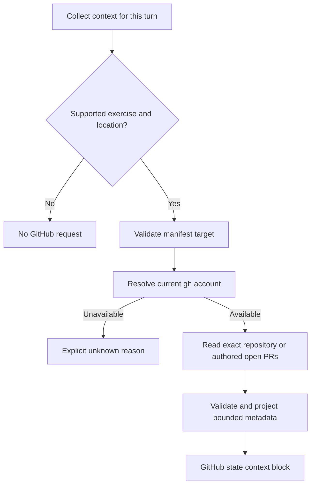

# GitHub context for AI hints

AI Hints collects fresh, read-only GitHub metadata for four exercises using the learner's existing
GitHub CLI authentication. This supplements local repository evidence with fork ancestry, repository
visibility and open pull requests. It does not run verification or establish that an exercise passed.

**Status:** implemented, with deterministic provider and context-wiring tests and real subprocess
checks on macOS. Live API feasibility was checked before implementation on 6 November 2026.
Electron UI and live tutor interpretation have not been tested for this feature.

## Scope and target ownership

Local Git refs cannot establish that a repository is a GitHub fork, that it is public, or that an
open PR exists. A small, explicit exercise policy table supplies those missing observations.

| Exercise              | Account target                                      | Observations                                                      | Checks outside this provider                                    |
| --------------------- | --------------------------------------------------- | ----------------------------------------------------------------- | --------------------------------------------------------------- |
| `fork-repo`           | `<login>/gm-shapes`                                 | Repository identity, visibility, fork flag, direct parent         | Verification result                                             |
| `clone-repo`          | `<login>/gm-shapes`                                 | Same fork metadata                                                | Local `shapes` clone and `origin`/`upstream`                    |
| `remote-control`      | `<login>/gitmastery-<login>-remote-control`         | Repository identity and public/private visibility                 | URL submitted to interactive verification                       |
| `create-pr-from-main` | Open PRs by `<login>` in `git-mastery/gm-languages` | Candidate count, selected PR, head/base, draft state, head commit | Committed `Java.txt` content in the verifier's selected version |

The table is keyed by the app's exercise ID. These targets come from public task requirements.
They are not inferred from learner prose, local remote URLs, lesson HTML or arbitrary manifest
URLs. A wrong local `origin` must not redirect the GitHub observation to an unrelated repository.

Only GitHub.com is supported. Other exercises, hands-on practicals and missing exercise locations
make no GitHub requests. Lesson chats already omit workspace collection. A downloaded manifest is
required, but a local Git repository is not: fork/clone exercises use `repo_type: ignore`.

For the PR exercise, supplied `repo_title` and `pr_repo_full_name` fields must match the known
course target. Conflicting or malformed values produce `unknown: unsupported-target` without a
request. Missing legacy fields use the explicit policy. Stored `pr_number` is ignored because it
is verification history, not a current selection.

## Requirements checked against the verifiers

The exercise source revision used to establish the policies is
[`d00473c6425b9b16e6892a58fa1acf0e3df816b1`](https://github.com/git-mastery/exercises/tree/d00473c6425b9b16e6892a58fa1acf0e3df816b1).
The table must be reviewed when those exercises change.

### Fork and clone

[`fork_repo/verify.py`](https://github.com/git-mastery/exercises/blob/d00473c6425b9b16e6892a58fa1acf0e3df816b1/fork_repo/verify.py)
obtains the account using `gh api user`, looks for `<login>/gm-shapes`, checks `isFork`, and checks
that the direct parent's owner is `git-mastery`. The task names `git-mastery/gm-shapes`; the
verifier's parent comparison is owner-only. The provider reports the full observed direct parent
without inventing a stronger grading condition.

[`clone_repo/verify.py`](https://github.com/git-mastery/exercises/blob/d00473c6425b9b16e6892a58fa1acf0e3df816b1/clone_repo/verify.py)
also requires a local `shapes` folder, `origin` pointing to the learner's fork and `upstream`
pointing to `git-mastery/gm-shapes`. GitHub metadata alone cannot establish these local conditions.

### Public repository and interactive URL

[`remote_control/verify.py`](https://github.com/git-mastery/exercises/blob/d00473c6425b9b16e6892a58fa1acf0e3df816b1/remote_control/verify.py)
expects the account-specific repository to be public and calls Python `input()` to compare a
submitted URL with the expected HTTPS URL. Metadata establishes visibility, not the submitted
value. The desktop's [verification subprocess](../src/electron/ipc/gitmastery.ts) does not relay
this input. The context block retains that limitation; this feature does not change verification.

### Pull request selection

[`create_pr_from_main/verify.py`](https://github.com/git-mastery/exercises/blob/d00473c6425b9b16e6892a58fa1acf0e3df816b1/create_pr_from_main/verify.py)
selects the largest returned open PR number for the learner in the course repository, requires
head branch `main`, and examines `Java.txt` on `last_user_commit`. It does not explicitly require
a particular base branch, title, body, draft state or review status.

The shared
[`get_pr_numbers_by_author`](https://github.com/git-mastery/exercises/blob/d00473c6425b9b16e6892a58fa1acf0e3df816b1/exercise_utils/github_cli.py)
uses `gh pr list --author <login> --state open --json number` without a limit override. GitHub CLI's
documented default is 30, so the provider explicitly requests 30 and selects the highest returned
number. It does not filter head/base: an older PR on `main` must not hide a newer wrong-head PR.

At 30 results, the block says additional candidates may exist. An empty successful result means
no matching **open** PR was returned; closed and merged PRs were not queried. Search indexing can
also delay newly created PRs.

[`download.py`](https://github.com/git-mastery/exercises/blob/d00473c6425b9b16e6892a58fa1acf0e3df816b1/create_pr_from_main/download.py)
sets `pr_repo_full_name` to `git-mastery/gm-languages`. It is a setup hint to validate, not fresh
evidence. The relationship between GitHub's `headRefOid` and the autograder's `last_user_commit`
abstraction has not been established. Remote file bodies and content grading are deferred.

## Collection and implementation



| File                                                        | Responsibility                                                                        |
| ----------------------------------------------------------- | ------------------------------------------------------------------------------------- |
| [githubCli.ts](../src/electron/ai/githubCli.ts)             | Three read operations, process boundary, response validation and error classification |
| [githubState.ts](../src/electron/ai/context/githubState.ts) | Four policies, setup validation, candidate selection and context wording              |
| [context.ts](../src/electron/ai/context.ts)                 | Provider registration and propagation of the turn's abort signal                      |
| [prompt.ts](../src/electron/ai/prompt.ts)                   | Account identity, freshness, unknowns and unchecked requirements                      |
| [exerciseManifest.ts](../src/electron/exerciseManifest.ts)  | Optional `pr_repo_full_name` setup field                                              |

The provider returns the existing block shape, with ID `github-state` and label `GitHub state`.
The existing chat pipeline sends the block in the system prompt and exposes the same context in
the expandable disclosure. No new IPC message, account picker, settings page or renderer component
is necessary.

The adapter accepts an injectable runner. Production uses `execFile` with an argument array,
closed stdin, no shell and no TTY. The commands are equivalent to:

```text
gh api --hostname github.com --method GET --include \
  -H "X-GitHub-Api-Version: 2022-11-28" user
gh api --hostname github.com --method GET --include \
  -H "X-GitHub-Api-Version: 2022-11-28" repos/<owner>/<repository>
gh pr list --repo github.com/git-mastery/gm-languages --author <login> \
  --state open --limit 30 \
  --json number,state,isDraft,headRefName,headRefOid,headRepository,headRepositoryOwner,baseRefName
```

The canonical PR URL is constructed from the fixed course target and validated numeric PR ID.
The PR command is read-only but may internally use GraphQL/search and multiple network requests;
it is not described as a single HTTP GET.

### Authentication and data boundary

The adapter uses `getCliEnvironment()` for the desktop application's PATH and preserves normal
GitHub CLI authentication, including token environment variables. This matches the verifier's
account choice; it does not introduce another OAuth identity or extract/store a token.
The resolved GitHub login is sent as context so account mistakes are diagnosable.

Explicit hosts/targets and `GH_HOST=github.com` avoid cwd and `GH_REPO` ambiguity. The child sets
`GH_PROMPT_DISABLED`, both update-notifier disabling variables, `GH_TELEMETRY=0`,
`DO_NOT_TRACK=1` and `NO_COLOR`. Debug and forced-terminal/color environment settings are removed.
It never launches authentication, installs a CLI, fetches Git refs or runs a verifier.

Only validated fields are projected. The block omits profile data, emails, tokens, repository
descriptions, PR titles/bodies, comments, reviews and file bodies. Raw subprocess errors, response
bodies and environment values are never logged or returned to the model by this adapter.

Login and repository names are validated before use in arguments. Responses must contain valid
identities, visibility, booleans, bounded refs and commit IDs. Unknown object fields are discarded.
A renamed repository reports its returned identity and mismatch with the expected name. A missing
parent or deleted PR head repository remains unknown; neither is guessed from another field.

The process may read GitHub CLI's credential store and perform its own bookkeeping. “Read-only”
describes the exercise and GitHub operations, not a guarantee that `gh` never touches its config.
Networking follows `gh` and its proxy environment, not Electron's network stack.

### Unknowns and evidence semantics

| Observation                                             | Interpretation                                                     |
| ------------------------------------------------------- | ------------------------------------------------------------------ |
| Successful response with `fork=false`                   | Observed repository is not a fork                                  |
| Successful private visibility                           | Observed repository is private                                     |
| Different direct parent or returned repository identity | Report the observed mismatch                                       |
| HTTP 404                                                | Not found **or inaccessible**; existence/visibility remain unknown |
| CLI missing / exit 4                                    | `cli-missing` / `auth-required`                                    |
| HTTP 401                                                | `auth-rejected`; do not fall back to a previous account            |
| HTTP 403                                                | `forbidden`, unless explicit rate-limit evidence is present        |
| HTTP 429 or confirmed rate-limit response               | `rate-limited`                                                     |
| Child timeout / collection deadline                     | `timeout`                                                          |
| Invalid JSON, fields, oversized output                  | `invalid-response`                                                 |
| Unclassified process/network failure                    | `network`; no claim about learner work                             |
| Empty successful PR list                                | No matching open candidate returned at query time                  |
| PR result at the cap                                    | Candidate set is bounded, not an exact account-wide total          |

REST parsing supports LF/CRLF and preceding response headers, including a nonzero process exit
with HTTP status in stdout. GraphQL process failures have fewer structured details; only explicit
status/rate-limit hints are classified, and other failures remain unknown.

Each block records its observation window and current account. Separate requests are observations
over that window, not an atomic snapshot. The prompt places current observations above older
assistant guesses and keeps the account distinct from Git commit authors and repository owners.
Metadata never changes progress, creates a passing attempt or proves submitted file content.

### Deadlines and freshness

The existing outer provider ceiling is 2,500 ms. GitHub collection has an inner 2,100 ms abort
deadline and each subprocess a 1,500 ms timeout. The shared abort signal cuts a later child short
when less collection time remains. Children use `SIGKILL` on timeout/abort and cap captured output
at 1 MiB. The projected block stays below the existing 8,000-character cap.

A lookup timeout preserves an already resolved account and marks the requested facts unknown.
User cancellation aborts the child and suppresses the entire late block. Other context providers
still run independently, and GitHub failures do not prevent local context or chat.

Every supported send normally performs identity plus one lookup. No repository, PR or identity
result is cached or retried. The sole retained state is a host retry-not-before timestamp after
confirmed rate limiting: honor `Retry-After` or `X-RateLimit-Reset`, otherwise wait 60 seconds.
During that cooldown, return unknown without replaying stale facts. A host-level cooldown also
covers failures before the account can be resolved; switching accounts does not bypass it.

## Feasibility evidence collected before implementation

Real `gh` subprocesses were checked on macOS with GitHub CLI 2.97.0 and Node 20.20.2 on
6 November 2026. REST probes used the accepted `2022-11-28` API version, a five-second timeout
and a 1 MiB output cap. They did not create or mutate a repository, fork or PR, run verification,
fetch, checkout, login or logout. Learner-specific account/resource names are not retained here.

| Probe                                                        | Observed result                                                    |
| ------------------------------------------------------------ | ------------------------------------------------------------------ |
| `gh api user --jq .login`                                    | Identity resolved; first measured call 441 ms                      |
| `git-mastery/gm-shapes`                                      | Public, not a fork; 566 ms                                         |
| `damithc/gm-shapes`                                          | Public fork, direct parent `git-mastery/gm-shapes`; 564 ms         |
| Author-filtered open PR query on `git-mastery/gm-languages`  | Public example #15, head/base `main`, head SHA available; 1,155 ms |
| Same query with nonexistent author                           | Successful empty array; 595 ms                                     |
| Exact account fork and remote-control targets                | Both 404; about 415–417 ms                                         |
| Deliberately missing public repository with response headers | HTTP 404, exit 1; 455 ms                                           |
| Invalid token confined to one child                          | HTTP 401, exit 1; 329 ms                                           |
| Empty config directory and minimal child environment         | Exit 4 with login guidance                                         |
| AbortSignal applied to real `gh api` child                   | `ABORT_ERR` observed in 4 ms                                       |
| Identity plus repository, three sequential samples           | 1,162 / 954 / 1,143 ms total                                       |
| Public PR's `Java.txt` at fixed head SHA                     | File metadata available, size 23 bytes and blob SHA                |

The last probe used head SHA `212eee5c34e29b0b2481ae65034cffca3a755a4b` and projected file
metadata only. It establishes technical feasibility of a future pinned-content request, not
equivalence to the verifier's selected commit or permission to send remote bodies in this feature.

Merely changing `GH_CONFIG_DIR` and removing the two common token variables still authenticated
with the inherited environment. A minimal environment then produced exit 4. Therefore an empty
config directory is not a reliable test-network boundary; routine tests use fake process results.

These timings are samples, not reliability percentiles. They do not establish performance on slow
networks or the full identity-plus-PR path. Private repository success, real SSO restrictions,
actual rate limiting and Windows/Linux runtime behavior were not live-tested.

## Testability and validation

[githubContext.test.ts](../tests/electron/ai/githubContext.test.ts) exercises the real adapter and
provider with injected process responses and temporary manifests. It covers all four policies,
no-local-repository setup, conflicting targets, account changes, renamed/private/non-fork metadata,
404/401/403/429, missing authentication/CLI, invalid fields/JSON, rate cooldown, bounded PR
selection, deleted head repositories, changed PR state, cancellation and collection timeout.
Unrelated profile/error content must not reach the block.

The same suite runs actual child processes using a Node fixture with no GitHub access. These
checks cover argument boundaries, stdin closure, timeout, cancellation and output overflow.
They exercise the production process function without relying on PATH shims or stored credentials.

[githubWiring.test.ts](../tests/electron/ai/githubWiring.test.ts) uses the actual context registry,
GitHub provider and prompt builder, with other providers and the GitHub runner isolated. It
verifies no-open-PR → new-PR refresh across successive calls, the disclosed block's identity,
prompt limitations, preserved local context during authentication failure and cancelled collection.

Run:

```sh
npm test
npm run transpile:electron
npx tsc -p tsconfig.test.json
npm run format
npm run lint
```

An opt-in [live smoke test](../tests/electron/ai/githubLive.test.ts) uses real `gh` authentication
and the production adapter to read identity, the known public source/fork, and authored PR lists:

```sh
GIT_MASTERY_GITHUB_SMOKE=1 npm test -- tests/electron/ai/githubLive.test.ts
```

It is skipped in routine runs and needs working GitHub access. Public examples can change over
time. It does not print the authenticated learner's login or change GitHub resources.

On 6 November 2026, all 107 deterministic tests and both opt-in live adapter tests passed on
macOS. Main-process/test typechecks, the production build and ESLint also passed. The live
adapter checks confirm response compatibility under the per-child timeout; they do not measure
the complete two-request provider deadline or establish UI/tutor behavior.

The tests' imports reach main-process modules that earlier tests did not compile. The test config
includes `DOM.AsyncIterable` for AI SDK streams, and `WebFrameMain` uses a type-only import so
those modules also compile under the test config's `verbatimModuleSyntax`.

### Remaining validation

- Electron UI send/disclosure behavior is not covered by these tests. A future E2E test should
  change fake GitHub state between two sends in the same chat and inspect both model requests and
  disclosure. The `main` baseline for this feature has no Electron E2E harness.
- An Electron browser/network mock does not intercept a `gh` subprocess. Any future harness must
  install a fake runner before the provider is constructed and must never fall through to real
  GitHub. A fake model tests wiring, not tutoring quality.
- Windows/Linux process handling needs runtime validation there. Portable argument arrays and
  Node fixtures make the deterministic tests runnable without GitHub credentials.
- Live tutor evaluation should check 404 uncertainty, changed facts, wrong-head selection, and
  refusal to claim submitted content or complete exercise success from metadata alone.

## Alternatives and tradeoffs

| Alternative                                 | Reason for the chosen approach                                                                  |
| ------------------------------------------- | ----------------------------------------------------------------------------------------------- |
| Infer requirements from remotes             | Cannot observe a fork before cloning; a wrong remote redirects the query                        |
| Derive every target from current manifests  | Three account target names are absent; setup flags do not prove live state                      |
| Require a new catalog metadata schema first | Adds coordination for four known tasks; a versioned catalog policy can replace this table later |
| Add OAuth or extract tokens for direct HTTP | Adds an authentication lifecycle and can disagree with the verifier's identity                  |
| Use public unauthenticated REST only        | Cannot identify the learner or observe accessible private visibility                            |
| Filter PRs by head `main`                   | Hides the wrong-head candidate selected by verification                                         |
| Search the entire account                   | Collects unrelated data and adds latency                                                        |
| Fetch refs or run verification for context  | Can mutate learner state or wait for interactive input                                          |
| Read PR file bodies now                     | Requires a content boundary and exact autograder commit semantics                               |
| Cache positive/negative facts               | Can repeat stale diagnoses after the learner fixes their work                                   |

## References

- [GitHub CLI API command](https://cli.github.com/manual/gh_api)
- [GitHub CLI PR list fields and limits](https://cli.github.com/manual/gh_pr_list)
- [GitHub CLI authentication and environment controls](https://cli.github.com/manual/gh_help_environment)
- [GitHub REST troubleshooting, permissions and ambiguous 404s](https://docs.github.com/en/rest/using-the-rest-api/troubleshooting-the-rest-api)
- [Existing context providers](architecture/ai-context-providers.md)
