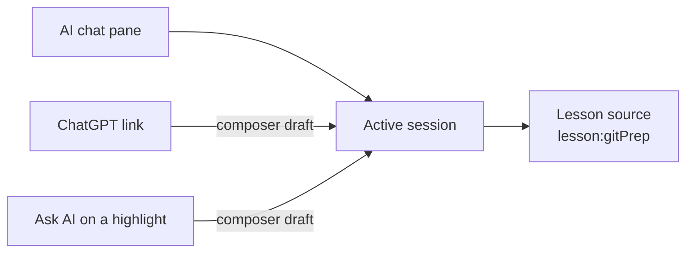
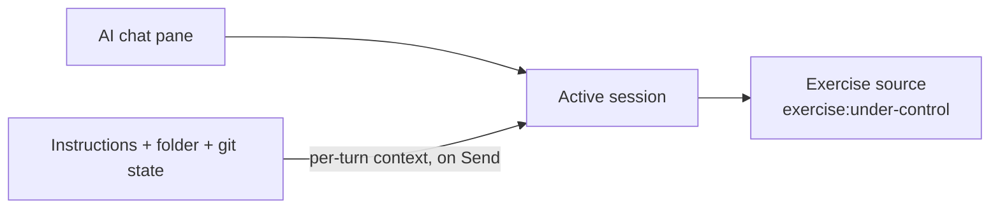

# AI chat sources and sessions

**Status:** Implemented. Disk persistence is in `ai-chat-persistence.md`.

The AI Hints pane is one container. It shows at most one conversation, keyed by what the student
is asking about (the **source**). Every way into the pane — an AI Hints button, a ChatGPT link, or
Ask AI on a highlight — chooses that source. The question is never sent until they click Send.

## Model

| Concept            | Role                                                                                     |
| ------------------ | ---------------------------------------------------------------------------------------- |
| **Pane**           | The single visible chat above the terminal.                                              |
| **Session**        | One conversation for one source. Switching sources does not delete others.               |
| **Source**         | What the conversation is about: a lesson, an exercise, or a hands-on.                    |
| **Composer draft** | Text sitting in the input, not yet a message. ChatGPT links and Ask AI both set this.    |
| **Message**        | What they actually sent. The draft becomes a user message only on Send.                  |
| **Context**        | Data the app attaches on send (exercise instructions, folder, git state). Not the draft. |






```ts
type AiSource =
  | {
      sourceKey: `lesson:${string}`;
      kind: "lesson";
      id: string;
      title: string;
    }
  | {
      sourceKey: `exercise:${string}`;
      kind: "exercise";
      id: string;
      title: string;
    }
  | {
      sourceKey: `hands-on:${string}`;
      kind: "hands-on";
      id: string;
      title: string;
    };

type AiSession = {
  source: AiSource;
  conversationId: string;
  updatedAt: string;
  messages: GitMasteryUIMessage[];
};

type AiChatState = {
  activeSourceKey: string | null;
  sessionsBySource: Record<string, AiSession>;
};
```

The renderer keeps `sessionsBySource` as a `Record` hydrated from `ai-history.json`.

| Kind     | `id`                | Example                          |
| -------- | ------------------- | -------------------------------- |
| Lesson   | Lesson URL segment  | `gitPrep` in `/lessons/gitPrep/` |
| Exercise | Download identifier | `under-control`                  |
| Hands-on | Download identifier | `hp-init-repo`                   |

The source is never the highlight, the ChatGPT `q=`, or a hash of the text. Every entry point
returns the source's namespaced `sourceKey`.

## How a source is chosen

The **entry point** picks the source. The pane then shows that source's session. A different
session already on screen is left intact (including any draft); it is just no longer visible.

| Entry point                                           | Source                                                          |
| ----------------------------------------------------- | --------------------------------------------------------------- |
| **AI Hints** on an exercise card                      | `exercise:{id}`                                                 |
| **AI Hints** / **Start Hands-on** help on a practical | `hands-on:{id}`                                                 |
| ChatGPT `?q=` link on a lesson page                   | `lesson:{page}` from the URL, even if the link sits near a card |
| **Ask AI** on a highlight                             | The box that **contains** the selection (table below)           |

### Ask AI: which box contains the highlight

The student selects text, right-clicks, and chooses **Ask AI**. Highlighting by itself does nothing:
it does not open the pane, change session, or fill the input.

The range must be contained in **one** workspace box. Those boxes are the same ones used to scrape
instructions: an exercise `.card` headed `#exercise-{id}`, or a `.hands-on-practical` with
`data-gm-hands-on-id`.

| Selection is contained in                           | Source                       |
| --------------------------------------------------- | ---------------------------- |
| One exercise card `#exercise-{id}`                  | `exercise:{id}`              |
| One hands-on box `.hands-on-practical`              | `hands-on:{id}`              |
| Anywhere else on a lesson page                      | `lesson:{page}` from the URL |
| Across lesson prose and a card, or across two cards | `lesson:{page}`              |
| Whitespace only, or not a lesson page               | No **Ask AI** item           |

Exercise and hands-on Ask AI still open that workspace session if the folder is not on disk yet.
Context collection already skips a missing folder; the graded / guided policy is the reason to
route card text there instead of to the lesson. If AI is not configured, there is no Ask AI (ChatGPT
links keep their browser popup).

### Ask AI when another session is showing

The highlight's box wins. Do not append to the visible chat, and do not ask which chat to use. The
header pill changing (`Exercise` → `Lesson`, and so on) is the signal.

| Visible session              | They Ask AI on                        | Result                                                                                                       |
| ---------------------------- | ------------------------------------- | ------------------------------------------------------------------------------------------------------------ |
| Closed pane                  | Any valid highlight                   | Open the pane on the source in the table above. Put the text in that session's input.                        |
| Same source as the highlight | Highlight in that source              | Keep the conversation. Replace the input with the new highlight.                                             |
| `exercise:under-control`     | Lesson prose                          | Switch to `lesson:{page}`. Exercise session (messages and draft) unchanged. Lesson input gets the highlight. |
| `lesson:init`                | Text inside `EXERCISE: under-control` | Switch to `exercise:under-control`. Lesson session unchanged. Exercise input gets the highlight.             |
| `exercise:under-control`     | Text inside a different exercise card | Switch to that exercise. First exercise session unchanged.                                                   |
| `hands-on:hp-init-repo`      | Lesson prose                          | Switch to `lesson:{page}`. Hands-on session unchanged.                                                       |

## What lands in the input

Ask AI and ChatGPT links both set a **composer draft**. They do not send. They do not add a quote
chip or a separate `selectedText` field. The student can edit the input and must click Send.

| Gesture                                       | Input                                                                    | Send |
| --------------------------------------------- | ------------------------------------------------------------------------ | ---- |
| **Ask AI**                                    | The selected text, replacing whatever was in that session's input        | No   |
| ChatGPT link                                  | The decoded `q=`, replacing that lesson session's input                  | No   |
| Another Ask AI or link on the **same** source | Replaces the current draft (new draft id, even if the text is identical) | No   |
| Ask AI or link that **switches** source       | Draft is written on the **target** session only                          | No   |
| Send                                          | Draft becomes a normal user message                                      | Yes  |
| Clear / close                                 | Drafts are not persisted. Close hides the pane; the session remains.     | —    |

A later title scrape may update the pane title; it must not re-seed the input.

## ChatGPT link interception

The published lessons currently contain 19 links with one consistent shape:
`https://chatgpt.com/?q=<encoded prompt>`, all opened with `target="_blank"`.

The `WebContentsView` popup handler:

1. Matches the exact `https:` protocol, `chatgpt.com` hostname, `/` path, and a non-empty `q`.
2. Reads the current lesson id from the embedded page URL, and the title from the page.
3. Denies the popup when AI is configured and the page is a lesson.
4. Opens or reuses that lesson's session and puts the decoded `q` in the composer (keyed by a prompt
   id so every click is a new draft).

Other popup URLs keep their existing behavior. If no AI provider is configured, or the page is not a
lesson, the original ChatGPT popup remains available.

## Session lifecycle

- The first entry point for a source creates its session and opens the pane.
- Returning to a source restores its conversation, including after restart.
- Closing the pane hides it without clearing the active session.
- **Clear history** deletes that source from memory and disk, then opens a fresh empty session for
  the same source. The empty session is not written until the next completed turn.

## Prompt policy

Policy follows the source kind, which is why Ask AI must not dump card text into a lesson session:

- **Lesson:** explain Git, GitHub, terminal, and Git-Mastery concepts; no exercise workspace is
  collected or required.
- **Exercise:** graded-exercise hint policy and repository context when the folder exists.
- **Hands-on:** guided-practical policy and repository context when the folder exists.
