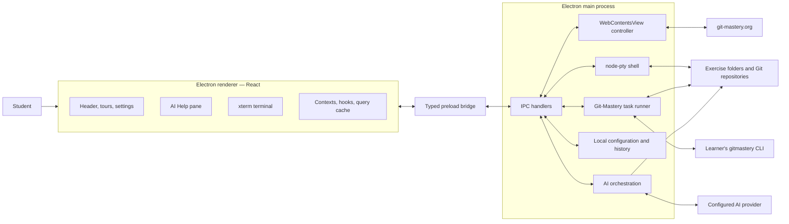
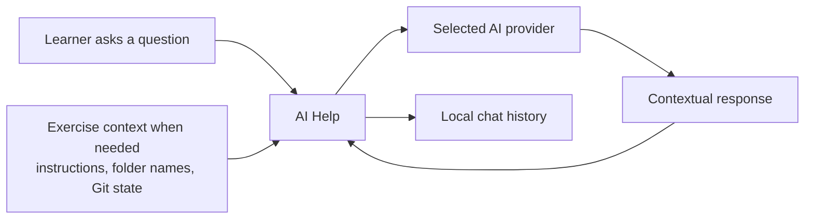

# Git-Mastery Desktop: Final Year Project Report

This report covers the development of Git-Mastery Desktop up to 19 October 2026, from its feasibility prototype to the current application and published desktop releases.

## 1. Background

### 1.1 Git-Mastery

[Git-Mastery](https://git-mastery.org) is an open-source learning environment for Git and GitHub. It combines:

- a web curriculum organised into tours and lessons;
- hands-on practicals that guide students through Git operations;
- graded exercises with prepared repositories and local verification;
- the `gitmastery` command-line application for setup, download, progress, and verification;
- exercise definitions, repository generators, and progress dashboards maintained in separate repositories.

This division is useful for maintainers, but it creates friction for a new learner. The instructions are in a browser, the work is done in a terminal, and exercise setup and verification are separate CLI operations. Learners must keep the correct lesson, repository, working directory, and command in view at the same time. Errors such as running Verify from the wrong directory can appear to be exercise failures even when the underlying problem is navigation.

Git-Mastery Desktop addresses this coordination problem. It does not replace the website or CLI. It places both in one desktop workspace and coordinates them: the website remains the source of teaching content, the learner's own `gitmastery` installation remains the source of exercise operations, and the desktop application manages navigation, terminal access, local state, and feedback.

### 1.2 Git-Mastery Desktop — Feasibility Prototype

The feasibility prototype began on 28 February 2026 as a React, TypeScript, Vite, and Electron scaffold. Work through April established that a desktop companion was technically viable. The prototype demonstrated:

- a single Electron window containing a React interface;
- an embedded `git-mastery.org` lesson view;
- a real interactive terminal backed by `node-pty`;
- Electron IPC between the interface and operating-system functions;
- tour and lesson navigation;
- controls injected into lesson pages to start and verify exercises;
- an initial setup flow;
- Windows and macOS packaging.

The prototype was developed rapidly with AI coding assistance. This established the technical direction early, while later work added the design rules, validation, documentation, and review practices needed to control AI-assisted changes.

The prototype proved the core interaction, but it was not yet a production application. It still had duplicated navigation, placeholder controls, weak error recovery, inconsistent setup paths, fragile exercise-directory heuristics, limited platform packaging, no release automation, and no durable AI session model. Much of the subsequent project therefore concerned correctness and product design rather than adding more screens.

### 1.3 Application Architecture

Git-Mastery Desktop is a local desktop orchestrator. It keeps privileged work in Electron's main process and presents the learning workspace through one React renderer and one embedded native web view.

#### 1.3.1 Process Architecture and Trust Boundaries

The main process owns capabilities that a web interface should not receive directly:

- creating and managing the application window;
- creating and resizing the embedded `WebContentsView`;
- spawning and controlling the pseudo-terminal;
- invoking the Git-Mastery CLI;
- resolving and validating exercise directories;
- reading Git repository metadata for AI context;
- reading and writing configuration and chat history;
- encrypting API keys through Electron `safeStorage`;
- making model requests through Chromium's network stack.

The main process is divided by responsibility. Terminal, configuration, Git-Mastery, embedded-site, setup, and AI operations have separate IPC handlers. This prevents the React interface from becoming responsible for filesystem or process management.

The React renderer does not import Node or Electron APIs directly. A preload script exposes a typed `window.electron` interface through `contextBridge`. The interface separates:

- fire-and-forget messages, such as writing to the terminal;
- request-response operations, such as loading settings;
- subscriptions, such as receiving terminal output or AI stream chunks.

Main-process IPC wrappers validate that normal application messages came from the local renderer URL. The external lesson view has a separate, much smaller preload bridge. Main handles only the expected lesson-page actions and re-validates identifiers and local state before starting an exercise or opening AI Help. The embedded page is therefore an input surface, not the authority for filesystem or process operations.

The renderer provides the desktop chrome:

- site navigation and settings;
- the tours and lesson outline;
- the terminal surface;
- the AI Help pane;
- setup, start, walkthrough, toast, and status interfaces.

React contexts and providers hold cross-cutting UI state such as theme, embedded-view visibility, activity state, lesson completion, and active AI sessions. Query hooks fetch the website's public catalogs and CustardUI configuration. Renderer `localStorage` holds display preferences that do not need main-process authority, including walkthrough completion, the last site URL, completed lessons, and a local copy of site-view preferences.

#### 1.3.2 Embedded Site and Local Tooling

The lesson site is loaded into a native `WebContentsView`, not an iframe. This allows the existing Git-Mastery site to remain the source of truth and avoids duplicating curriculum content in the desktop package.

The desktop controller:

- removes site chrome that duplicates the desktop header;
- injects Start, Verify, and AI Help controls into exercise and hands-on cards;
- reports page navigation to the renderer;
- writes CustardUI and MarkBind preferences into the site's origin storage;
- applies a Chrome-like user agent so YouTube embeds do not reject Electron;
- inserts temporary guards and dim layers during the walkthrough.

A native view paints above the renderer DOM. This constraint explains several design decisions: modals suppress the view, walkthrough overlays must be injected into the page, and AI Help is placed above the terminal instead of floating over the lesson.

The terminal uses `node-pty` and the learner's normal shell. On Windows, this is Git Bash; on macOS and Linux, it follows the platform shell environment. The terminal starts in the configured exercises root when that path exists and otherwise starts in the home directory.

Start and Verify do not run inside the interactive shell. Main starts the learner's own `gitmastery` executable as a controlled child process with an explicit working directory. Its output is also echoed into xterm, so the learner receives persistent scrollback while the application retains a clean stream for interpreting task completion. This avoids mixing structured CLI results with prompts, colour codes, and user keystrokes.

Exercise working directories are resolved from the CLI-written manifest. Exercises whose repository type is `ignore` use the exercise root; other exercises use the named repository folder. Hands-on practicals have no manifest, so a single sandbox subdirectory is used when present. Inputs must be single path segments before they are joined to the exercises root.

State is stored according to who needs it:

- Electron `config.json`: exercises root, start preference, theme, provider selection, and provider credentials;
- Electron `ai-history.json`: versioned, bounded, per-source visible chat transcripts;
- renderer `localStorage`: walkthrough status, last embedded URL, completed lessons, and desktop copies of site preferences;
- `git-mastery.org` origin `localStorage`: CustardUI content settings, course edition, and MarkBind theme;
- Git-Mastery's own files: exercise manifests and progress.

This separation avoids treating every preference as privileged state and avoids duplicating CLI-owned exercise data.

#### 1.3.3 Main Learner Flow and Trade-offs

1. The application opens the last valid Git-Mastery page and starts a terminal.
2. The learner selects a lesson, hands-on practical, or exercise.
3. On Start, main checks that the learner's CLI and exercises root are available.
4. If the activity is absent, main downloads it through the CLI. If it already exists, the download is skipped.
5. The manifest-based resolver selects the intended working directory, and the terminal changes to it.
6. For a graded exercise, Verify is allowed only when the terminal is in that directory. The CLI result updates the desktop feedback and CLI-owned progress.
7. If the learner requests AI Help, fresh instructions and repository metadata are collected and sent to the configured model under the policy for that activity type.

The architecture favours integration with the real Git-Mastery ecosystem over an isolated desktop reimplementation:

- Loading the live website avoids curriculum duplication, but injected controls and instruction scraping depend on the site's rendered structure.
- `WebContentsView` preserves the site's full behaviour, but its native layer requires explicit bounds synchronisation and special handling for overlays.
- Running Start and Verify as child processes gives main a clean result stream, but the interactive terminal and controlled task runner must coordinate their working-directory state.
- `node-pty` provides a real shell, but requires native compilation for every supported operating system and architecture.
- Live catalogs and model providers keep content and inference replaceable, but introduce network, quota, and third-party availability dependencies.

## 2. Project Objectives

### 2.1 PO1: Integrate AI into Git-Mastery Learning

Provide contextual, privacy-conscious AI tutoring that helps learners make progress without exposing unnecessary local data or simply giving away answers.

### 2.2 PO2: Enhance Usability, User Experience, and Correctness

Reduce the coordination burden of learning from a web curriculum while working in local repositories. Improve setup, navigation, progress tracking, customisation, feedback, session continuity, and user-facing correctness.

### 2.3 PO3: Move Git-Mastery Desktop from Prototype to Production

Develop the feasibility prototype into a reliable desktop product with repeatable releases, cross-platform packages, automated quality gates, and proportionate regression testing.

### 2.4 PO4: Leverage AI in the Project Engineering Workflow

Use AI to increase development throughput while preserving consistent design, reviewability, documentation, and human control.

## 3. Progress

### 3.1 PO1: Integrate AI into Git-Mastery Learning

#### 3.1.1 [Done] Contextual AI Help and Provider Access

**Problem.** Learners need help at the point where they are reading and working. A generic chat cannot identify the current lesson or repository state, while moving to a separate tool breaks the learning flow.

**Design considerations.** Useful help needs both proximity and continuity: the current lesson and terminal should remain visible, while each activity keeps its own conversation. Repository context should be added only when the activity requires it.

**Chosen solution.** AI Help appears above the terminal, keeping the lesson, response, and place to run commands visible together. Each activity has its own locally restored conversation. Exercise and hands-on entry points become available after AI is configured and the activity is started; lesson questions do not require an exercise folder. Existing lesson links place their question in the composer for review before sending.

The app gathers fresh context for each request, applies the policy for the activity type, and streams the selected provider's response. It supports OpenRouter, OpenAI, Anthropic, Google Gemini, Groq, and custom OpenAI-compatible services. Keys are checked when saved and encrypted when the operating system supports it.

Only the visible transcript is stored. Repository context, credentials, system instructions, incomplete replies, and unsent drafts are excluded. Clearing history affects only the active activity. Student-supplied credentials avoid project-wide inference cost and allow free, paid, local, or institution-provided services.

**Evaluation.** The design keeps assistance inside the learning workspace and preserves continuity per activity. Invalid keys, unavailable models, exhausted credit, and rate limits are explained in plain language. Current limits include plaintext local chat history, provider-dependent quotas and quality, and replies that cannot resume after interruption.

#### 3.1.2 [Done] Context Containment and Tutoring Policy

**Problem.** Instructions alone are not enough to diagnose a learner's current mistake, but sending a whole repository would expose unnecessary data. The assistant must also teach without completing graded work for the learner.

**Design considerations.** The model needs enough current state to diagnose a mistake, but not broad access to student work. Context should stay within the named activity, show the learner what was sent, and apply stricter answer rules to graded tasks.

**Chosen solution.** Exercises and hands-on practicals use a fresh restricted snapshot containing:

1. the current instructions;
2. question stems from files the exercise listed in its manifest, with answer lines omitted;
3. exercise progress and file or folder names;
4. read-only Git state: a short derived summary, then the raw commands, covering branches, recent commits, changed files, paused operations, and merge direction when Git can name it.

Collection is restricted to the activity folder. The application does not send:

- arbitrary file contents (question stems are the only exception);
- student answers from those question files;
- files outside that folder;
- home paths, usernames, or terminal history;
- credentials.

The **AI can see** section shows the context used for each response. If part cannot be collected, the request continues with the available information.

The tutoring policy changes by source. Lessons may explain concepts and examples without workspace context. Graded exercises diagnose the snapshot and give exactly one next step without answer-file values or completed file bodies. Hands-on practicals may explain the current command but should not run ahead. All policies stay within Git, GitHub, Git-Mastery, and the terminal skills needed for the activity.

**Evaluation.** The assistant receives enough state to diagnose common Git mistakes without arbitrary files, answers, credentials, paths, or terminal history. The context disclosure makes each request inspectable. Prompt policy cannot guarantee compliance, so exercise verification remains the authority for correctness.

#### 3.1.3 [Done] Evaluation of Free AI Providers

**Problem.** Free-model quality, availability, and quotas vary over time. A general question-answering benchmark would not show whether a model follows the product's tutoring and answer-withholding policy.

**Design considerations.** Provider comparisons need to reflect the actual tutoring experience, especially staying grounded and withholding answers. Repeated runs and separate availability checks reduce the chance of recommending a model because of one unusually good response.

**Chosen solution.** The evaluation:

1. tests the prompt, context shape, and default settings used by learners;
2. prepares representative graded states at the beginning, halfway point, and a plausible off-track point;
3. supplies only approved context, with no tools, arbitrary files, answers, or terminal history;
4. applies a binary rubric for readability, grounding, confidentiality, safe advice, diagnosis, restraint, answer withholding, and useful next action;
5. considers consistency, availability, rate limits, and setup cost separately from tutoring quality.

Providers with variable output are tested across independent runs, and the weakest completed run is used rather than the best.

**Evaluation.** Candidate-specific tasks, scores, results, and recommendations remain in the evaluation record. This keeps the report's method valid when providers, models, prompts, or thresholds change.

### 3.2 PO2: Enhance Usability, User Experience, and Correctness

#### 3.2.1 [Done] Unified Workspace and Just-in-Time Setup

**Problem.** Duplicated navigation and separate screens made the learner coordinate the curriculum, terminal, and activity controls. A long first-run wizard also required tools before the curriculum had introduced them.

**Design considerations.** Learners should not have to move between a local copy of the curriculum, a browser, and a terminal. Setup should also appear when it becomes relevant instead of blocking the first launch.

**Chosen solution.** The workspace uses three simultaneous surfaces:

- the curriculum and lesson outline;
- the live embedded lesson page;
- the work column containing AI Help and the terminal.

The terminal remains visible while the learner reads. AI Help shares the work column above it, and resize handles let the learner allocate space without changing the lesson width. The app opens directly to lessons. The first Start action explains the activity, checks for `gitmastery`, and asks for the exercises root only when needed. Setup links open the relevant lesson inside the app, and closing the dialog allows the next Start to resume the check.

Activity cards provide one-click Start and Verify actions. Start downloads missing work or resumes an existing activity, while Verify runs the grading check through the learner's CLI. The app handles the commands and keeps their output in the terminal, so learners do not need to type setup, download, or verification commands manually.

**Evaluation.** The live site remains the source of curriculum content, so it is not duplicated in the desktop package. Learners can read instructions, start or verify work, and use the terminal in one workspace. Prerequisite setup appears only when its purpose is clear.

#### 3.2.2 [Done] Reliable Activity Operations and Feedback

**Problem.** Folder-shape heuristics could select the wrong working directory, while Verify could run from an unrelated terminal location and report a navigation mistake as an incorrect solution. Process failures and duplicate actions could also leave unclear or stuck states.

**Design considerations.** Activity actions need to be predictable: Start should always take the learner to the right place, and Verify should distinguish a navigation mistake from an incorrect solution. Controlled processes and CLI-owned paths make those outcomes easier to explain.

**Chosen solution.** Start has one meaning in every state:

- download an absent activity or resume an existing one;
- move the terminal to the resolved working directory;
- prevent duplicate starts;
- report failures without discarding work.

The app runs the learner's own `gitmastery` executable as a controlled task and echoes its output to the terminal. Exercise directories come from the CLI-written manifest. Verify is allowed only when the terminal is in the resolved directory. Hands-on practicals use the same flow without Verify and select their sandbox when the download contains one subdirectory.

The root selector accepts the folder containing `.gitmastery.json`, or a parent containing exactly one valid root. Unlinking forgets the setting without deleting files. A fixed warning covers cloud-synchronised folders because they cannot be detected reliably.

**Evaluation.** Desktop and normal terminal use share the same CLI and files. Invalid roots, missing prerequisites, and process failures settle visibly. Detailed output remains in terminal scrollback, while toasts show only the activity and outcome. Buttons show progress and remain disabled until the action settles.

#### 3.2.3 [Done] Tutorial, Progress, Customisation, and Continuity

**Problem.** Learners needed a clear introduction to the combined workspace, direct access to each activity, visible progress, consistent preferences, and a way to continue after restarting.

**Design considerations.** Progress is most useful where learners choose what to do next. Preferences and restart state also need to follow the learner across the desktop interface, lesson site, and terminal instead of drifting between surfaces.

**Chosen solution.** On first launch, a short walkthrough introduces the lesson area and terminal one area at a time. It can be replayed from Help.

The left sidebar follows lesson order and includes hands-on practicals, exercises, and detours. Each item links to the relevant lesson section. Learners can mark lessons as done; each tour row fills from the left to show how many of its lessons are complete. Exercises show **Downloaded**, **In progress**, or **Completed**, and hands-on practicals show whether their sandbox is downloaded.

The Customisation panel controls Light, Dark, or System theme, lesson content and tabs, profile details, and course edition. These settings apply across the desktop interface, terminal, embedded lessons, and sidebar labels. The app also restores the last visited page and opens the terminal in the saved exercises folder.

**Evaluation.** Navigation and progress are available in one place, settings remain consistent across surfaces, and learners can resume where they stopped after restarting.

### 3.3 PO3: Move Git-Mastery Desktop from Prototype to Production

#### 3.3.1 [Done] Release and Cross-Platform Distribution

**Problem.** Prototype packaging was not a repeatable release process. The native `node-pty` dependency had to be compiled for each target, and independent platform jobs could otherwise produce an incomplete public release.

**Design considerations.** Releases should remain deliberate and inexpensive for normal merges, but users should not see a release until every supported platform is ready. Native builds also need platform-matched runners.

**Chosen solution.** A manual release pipeline performs three stages:

1. **Quality gate.** Run ESLint, Prettier checking, TypeScript compilation, and the deterministic regression suite.
2. **Version.** Use `semantic-release` to derive the version from conventional change titles, update release files, and create the version tag.
3. **Build and publish.** Package all targets in parallel, then publish one release only after every package succeeds.

The reusable build workflow produces:

- macOS arm64 DMG;
- macOS x64 DMG, compiled on an Intel runner;
- Windows x64 portable EXE and MSI;
- Linux x64 AppImage and DEB.

Installer creation is separated from publication. Artifact matching and version bootstrap are validated, native packages use matching build hardware, jobs have narrow permissions and timeouts, and a failed package can be rebuilt from the existing tag without hiding other platform results.

**Evaluation.** The pipeline creates all six expected files with consistent version, operating-system, and architecture names. Manual triggering keeps normal merges cheap and prevents accidental releases. Publishing only after all builds succeed prevents partial releases. The packages remain unsigned because signing credentials were unavailable, and no updater metadata is published because the application has no in-app updater.

#### 3.3.2 [Done] Deterministic Quality Gates and Regression Testing

**Problem.** Linting, formatting, and type checks catch structural defects but do not protect behavioural rules such as safe path resolution and chat-history validation. A full Electron or packaged end-to-end suite would add significant environment and maintenance cost.

**Design considerations.** Quality checks need to catch mistakes learners would experience without making CI depend on a fragile Electron window, live website, network, or model provider. Deterministic behaviour can be automated cheaply; native and third-party integrations are better checked manually until recurring failures justify more automation.

**Chosen solution.** The required quality gate combines ESLint, Prettier verification, TypeScript compilation, and a Vitest regression suite. A failing behavioural test blocks both normal CI and releases. The suite covers:

- safe exercise and hands-on working-directory resolution;
- AI source identities and supported URLs;
- ordering of lessons, exercises, detours, and hands-on activities;
- conversion of live AI messages into safe stored transcripts;
- validation, limits, quarantine, and atomic saving of chat history.

Pure transformations are tested as input-to-output contracts. Filesystem behaviour uses isolated temporary directories and real file operations, with only narrow Electron boundaries replaced. Tests do not require an Electron window, network, website, model provider, installed Git-Mastery CLI, user configuration, or existing repository.

**Evaluation.** The suite is fast and repeatable on developer machines and CI. Manual checks remain appropriate for packaged installers, terminal behaviour, the live lesson site, and model quality. Broader component, subprocess, or packaged tests are only justified when recurring failures outweigh their added cost.

### 3.4 PO4: Leverage AI in the Project Engineering Workflow

#### 3.4.1 [Done] AI-Assisted Engineering with Reusable Controls

**Problem.** AI can accelerate broad implementation and review work, but ad hoc instructions can produce inconsistent design, reverse architectural decisions, or bypass normal verification.

**Design considerations.** AI assistance is useful only when its output remains inspectable and project decisions survive beyond one chat session. Version-controlled guidance and normal validation make that support repeatable.

**Chosen solution.** AI supported implementation, refactoring, architectural analysis, documentation, review, and delivery. It was used most effectively for bounded work with inspectable outcomes, including repeated UI migrations, platform build changes, cross-process tracing, decision records, and consistent changes across related files.

The repository-local design skill records colour, typography, layouts, component patterns, accessibility, native-view constraints, prohibited visual patterns, and a UI checklist. The delivery skill standardises change inspection, concise conventional titles, structured descriptions, and manual validation cases. Repository rules define formatting, linting, documentation, and testing expectations.

AI-generated or modified work remains subject to:

- small, named changes with visible diffs;
- architecture records for non-obvious decisions;
- scenario-based manual checks;
- lint, formatting, and type checks;
- conventional change titles;
- human review and runtime verification.

Non-trivial decisions record the reasons behind manifest-based directory resolution, CLI output handling, AI Help placement, context containment, release design, and credential ownership.

**Evaluation.** AI increased the scope and speed of work across product design, packaging, AI integration, and documentation, and helped review broad changes for omissions. It still required correction around styling migrations, release bootstrap, native-view behaviour, platform paths, exercise state, and model quality. Cross-process behaviour, destructive filesystem cases, packaging, and teaching quality continue to require human judgement and runtime evidence.

## 4. Future Plans

### 4.1 PO1: Integrate AI into Git-Mastery Learning

### 4.2 PO2: Enhance Usability, User Experience, and Correctness

### 4.3 PO3: Move Git-Mastery Desktop from Prototype to Production

### 4.4 PO4: Leverage AI in the Project Engineering Workflow
