

  

 

<h1 align="center">Git-Mastery Desktop</h1>
<h2 align="center">Preliminary Report</h2>

 

  <strong>Final Year Project</strong> 
  School of Computing 
  National University of Singapore

 

Academic Year 2026/2027

> Source: [Notion](https://app.notion.com/p/Git-Mastery-Desktop-Preliminary-Report-4072cd68dc03812ebaadde20ed35bb2d?pvs=28)  
> Notion last edited: 28 October 2026, 14:56 UTC

## 1. Background and Motivation

### 1.1 Git-Mastery

[Git-Mastery](https://git-mastery.org) is an open-source learning environment for Git and GitHub. It is developed by a team based at the National University of Singapore School of Computing (NUS SoC), under the guidance of A/P Damith Chatura Rajapakse. It provides:

- a web curriculum organised into tours and lessons;
- hands-on practicals that guide learners through Git operations; and
- auto-graded exercises based on realistic Git scenarios that learners complete in their own Git environments.

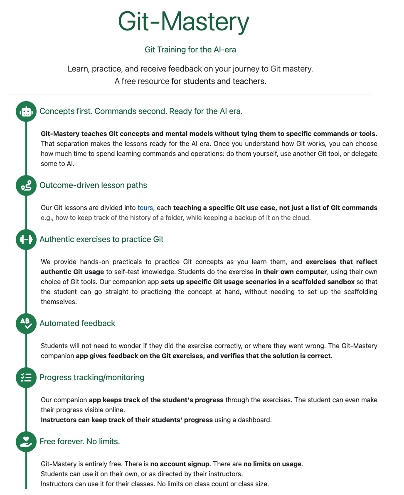

_Figure 1.1: Git-Mastery presents a concept-first curriculum supported by authentic practice and automated feedback._

The practicals and exercises are downloaded as repositories onto the learner's computer. Learners read the instructions in a browser and use the separately installed Git-Mastery CLI in a terminal to prepare each exercise. They then complete the exercise using the terminal or another Git interface, such as Sourcetree or GitHub Desktop, before using the CLI to verify their solution.

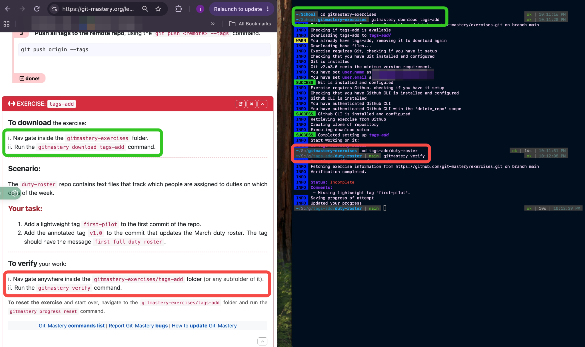

_Figure 1.2: The existing workflow requires learners to repeatedly switch between browser instructions and a separate terminal while manually coordinating exercise download via Git-Mastery CLI, folder navigation, Git work, and answer verification. Any additional help needed (eg. AI Assistance to understand and complete the exercises) requires a separate browser tab._

In this form, Git-Mastery is used by approximately 500–600 NUS students each year through related courses. As the main website has become relatively stable, the project's focus has shifted towards improving the user experience before making Git-Mastery available to a wider audience, including learners outside NUS.

### 1.2 A Unified Desktop Experience

One idea explored was a Git-Mastery Desktop application that would consolidate the learning workflow into a single interface. The application would continue to draw teaching content from the website while managing lesson navigation, terminal access, exercise setup, progress, and feedback. This would make Git-Mastery more convenient to use; for example, a learner could download an exercise by clicking a button instead of running a terminal command.

### 1.3 Feasibility Prototype

A previous student, Soh Zheng Yang, Marcus, developed a proof-of-concept prototype to investigate the feasibility of this idea. Built with React, TypeScript, Vite, and Electron, the prototype demonstrated:

- the Git-Mastery lesson website embedded within a desktop application;
- a real interactive terminal powered by `node-pty`;
- tour and lesson navigation;
- buttons added to lesson pages for starting and verifying exercises;
- communication between the user interface and operating-system functions; and
- basic Windows and macOS packaging.

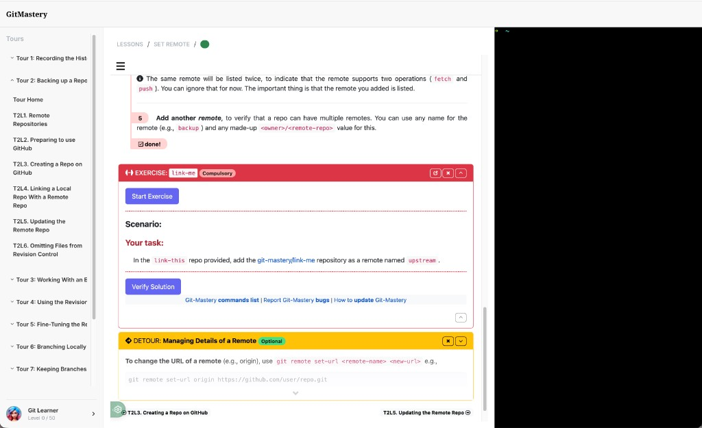

_Figure 1.3a: The prototype validates the unified workspace concept, but retains placeholder profile and level values, compressed navigation labels, and limited progress feedback._

The interface was still at proof-of-concept fidelity. Placeholder learner information and a static level indicator remained visible, long navigation labels were truncated, and completing activities did not produce dependable progress tracking.

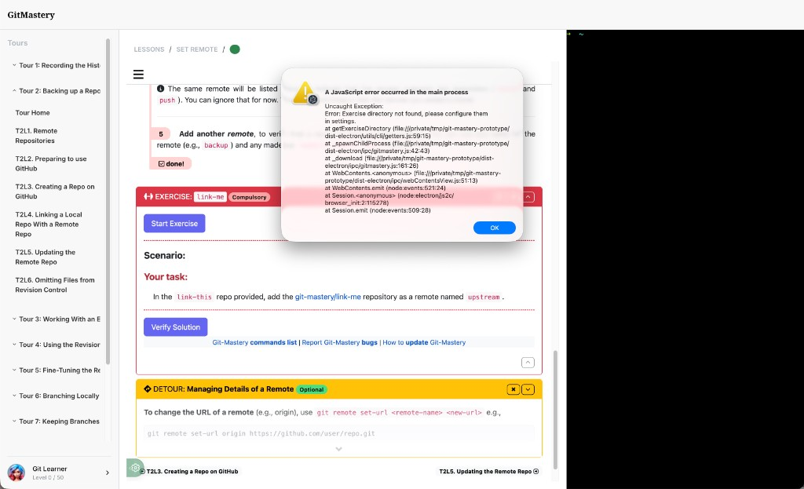

_Figure 1.3b: A missing directory causes an uncaught main-process exception._

Common user mistakes also had limited error handling. For example, starting an exercise before configuring the exercises directory surfaced an implementation-level exception and left the learner to diagnose the prerequisite.

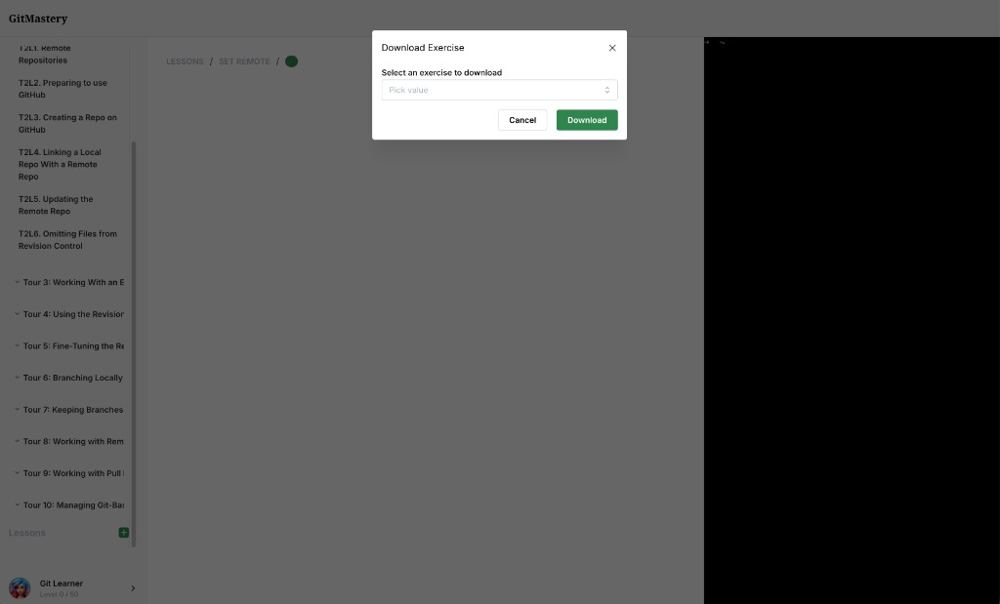

_Figure 1.3c: The separate download picker requires learners to select an exercise again instead of continuing directly from the activity they are viewing._

Exercise setup was similarly disjointed. Downloading was handled through a separate picker rather than a direct continuation from the lesson's exercise card, adding another selection step and an opportunity to choose the wrong exercise.

The prototype established that the core interaction was technically feasible. However, it was not ready for production use: it had limited error handling, no repeatable release process, little regression testing, and an inconsistent user interface. The remaining challenge was therefore to turn the prototype into a reliable and coherent product, improve developer experience, and add new high-value features such as AI assistance.

This Final Year Project (FYP) aims to develop the proof of concept further and bring Git-Mastery Desktop towards a production release. The specific project objectives are presented in the next section.

## 2. Project Objectives

### PO1: Enhance UX

Reduce the coordination required to learn from the web curriculum while working in local repositories. Improve setup, navigation, progress tracking, customisation, feedback, and session continuity.

### PO2: Add AI Features

Provide contextual and privacy-conscious AI tutoring that helps learners make progress without unnecessarily exposing local data or simply giving away exercise answers.

### PO3: Move to Production

Develop the feasibility prototype into a reliable desktop product with repeatable releases, cross-platform packages, automated quality checks, and regression testing for important behaviour.

### PO4: Improve Internals

Replace fragile prototype behaviour with explicit sources of truth, shared implementation paths, and clearer process boundaries. Make important operations safer for learners and easier for developers to understand and extend.

### PO5: Leverage AI for Development

Utilise AI coding agents and build systems around them to perform bounded, multi-step engineering work while preserving consistent design, reviewability, documentation, deterministic verification, and human control.

## 3. PO1: Enhance UX

### 3.1 Unified Workspace

The lesson website, Git-Mastery CLI, and terminal were previously separate interaction surfaces that users had to understand and manage. Users would read a lesson on [git-mastery.org](https://git-mastery.org), use the Git-Mastery CLI to prepare an exercise, navigate to the correct local folder in a terminal, complete the exercise, and run another command to verify it. For a new Git learner with minimal technical experience, this creates unnecessary friction.

These concepts are now consolidated into one workflow with three connected surfaces:

1. **The curriculum and lesson outline**
   The left sidebar allows users to navigate between tours, lessons, hands-on practicals, detours, and exercises. It also shows lesson and exercise progress in the same place.
2. **The live lesson page**
   The centre of the application displays the live version of the Git-Mastery lesson website. Instructions that normally ask users to download an exercise, navigate to its folder, or run commands are supplemented with direct Start and Verify buttons. When a user starts an exercise, the app first checks that the Git-Mastery CLI is available and that the user has selected a folder they want to work in. It then downloads the exercise if required and moves the terminal to the correct working directory. When the user requests feedback for their solution, the app runs the Git-Mastery CLI's exercise grading command and displays its output in the terminal.
3. **The work column**
   The right side contains an interactive terminal built with xterm.js. It is connected to the user's actual shell, allowing the learner to run normal Git and terminal commands without leaving the application.

Together, these surfaces reduce setup and navigation work while preserving the authentic experience of using Git through a terminal. This follows an established pattern in developer tools: Visual Studio Code provides a full terminal inside the workspace, starting it at the workspace root so users can run commands such as Git without moving to a separate application [1]. It provides a practical precedent for keeping related instructions, files, and command-line work in one place.

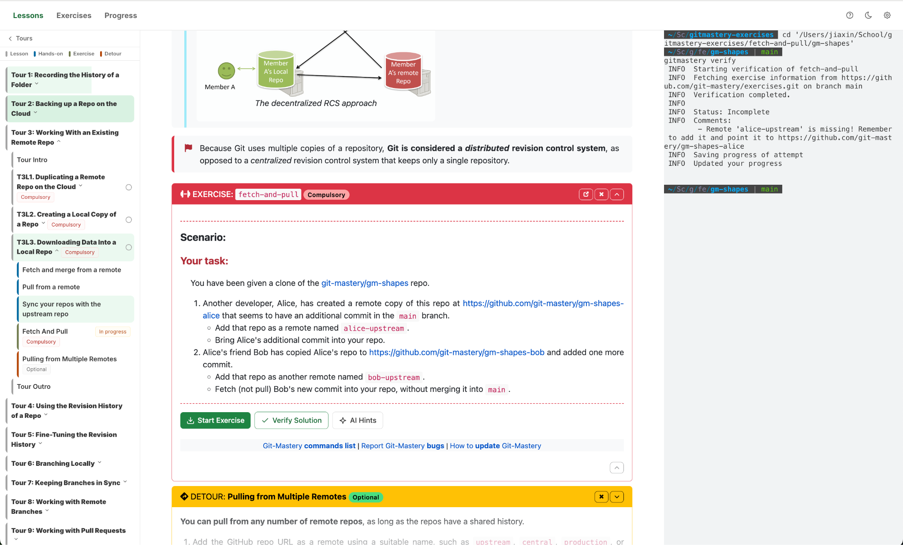

_Figure 3.1: The unified Git-Mastery Desktop workspace._

### 3.2 Onboarding, Progress Tracking, and Customisation

On first launch, a short walkthrough introduces the lesson area, sidebar, and terminal. It can be replayed from the Help button, so users are not expected to remember everything after one viewing. Visual Studio Code uses a similar Welcome page with self-guided walkthroughs that introduce setup, features, and customisation while tracking the user's progress [2].

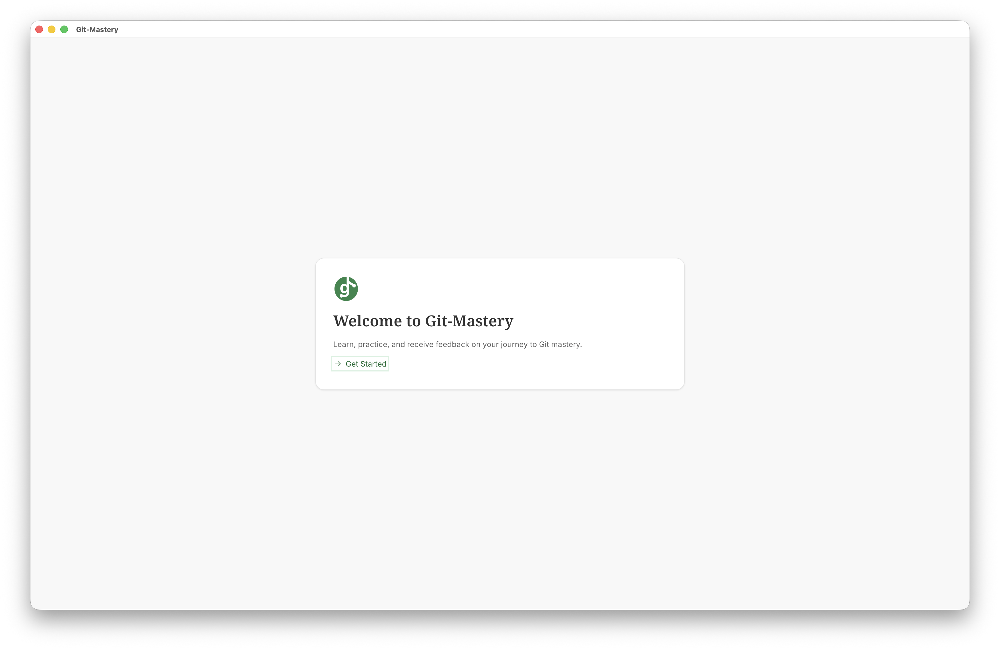

_Figure 3.2a: The walkthrough begins with a focused welcome screen._

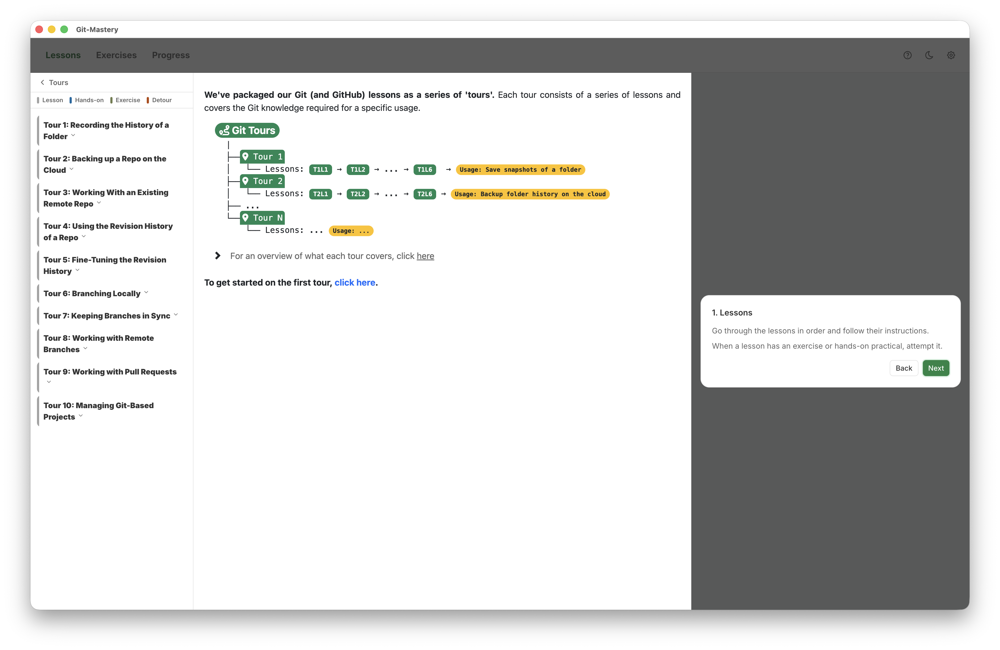

_Figure 3.2b: The walkthrough introduces the lesson page and curriculum sidebar._

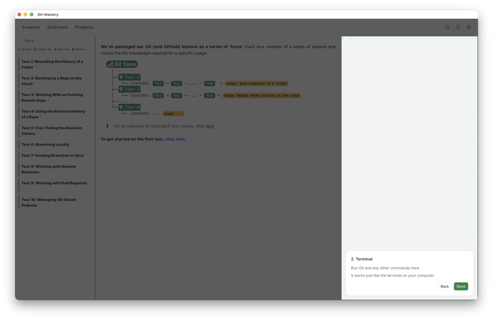

_Figure 3.2c: The walkthrough identifies the terminal as the learner's working area._

The first time an exercise is started, the app also explains the workflow and checks that the required CLI and exercises folder are available. If setup is incomplete (eg. Git-Mastery CLI is not installed), the app links the learner back to the relevant lesson.

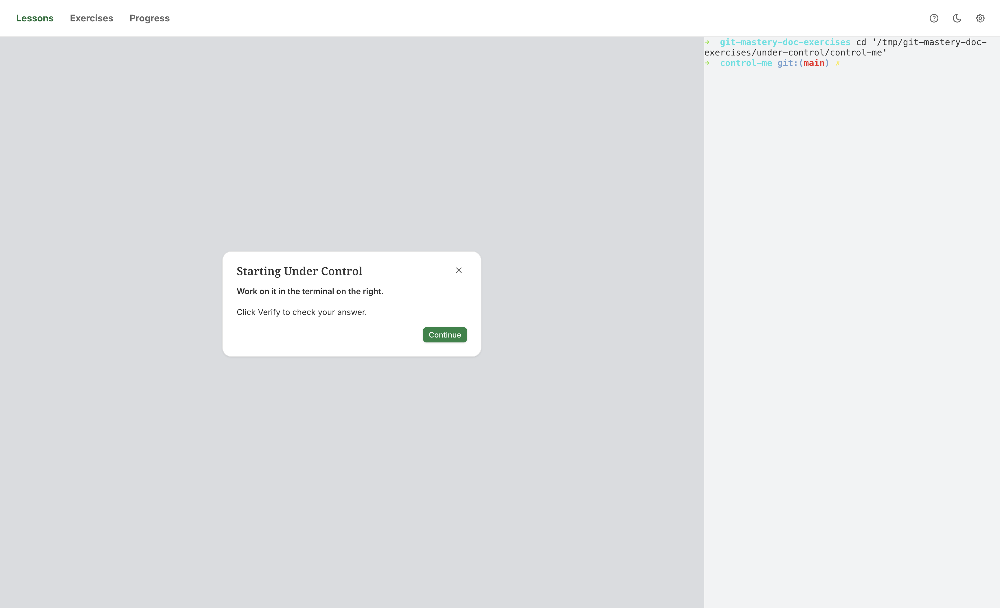

_Figure 3.3: Starting an exercise moves the terminal to its working folder and explains how to continue._

Learners can mark individual lessons as complete. A progress bar summarises the percentage of lessons completed within each tour. The sidebar separately shows whether exercises are not downloaded, in progress, or completed.

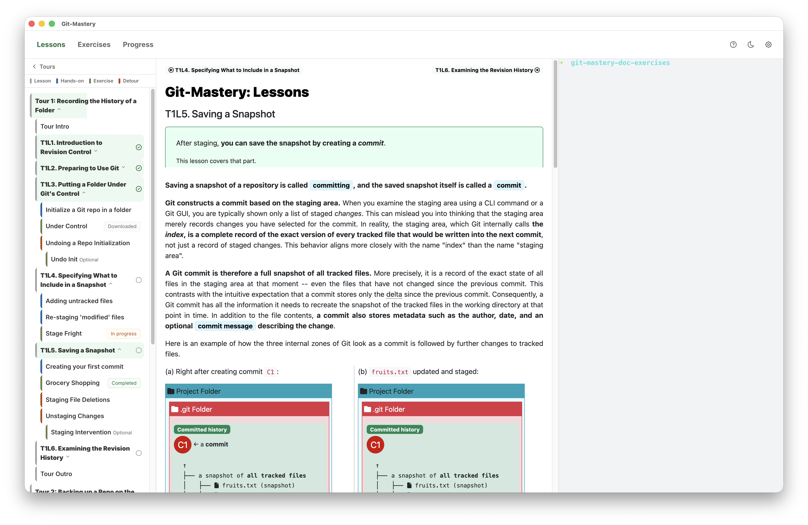

_Figure 3.4: The curriculum sidebar records lesson completion and distinguishes downloaded, in-progress, and completed exercises._

There is research support for making progress visible. A meta-analysis of 138 studies involving 19,951 participants found that interventions which encouraged people to monitor their progress improved goal attainment, with stronger effects when progress was physically recorded [3]. The lesson checkboxes and tour progress bars apply this principle by giving learners a persistent record of what they have completed. They are still a design hypothesis for this particular learning context and will be evaluated during field testing.

The app restores the last visited lesson after restart. AI conversations are also stored per lesson, exercise, or hands-on practical, so changing activities does not erase an earlier discussion. Together with the progress states in the sidebar, this reduces the need for learners to remember where they stopped. This follows the established usability principle of recognition rather than recall, which recommends keeping relevant actions and information visible or easily retrievable instead of relying on the user's memory [4].

The Customisation panel allows learners to:

- show, hide, or preview lesson content;
- choose operating-system and Git-interface tabs;
- set profile details used by the lesson website; and
- select a course edition.

Those content settings are applied consistently across embedded lessons and sidebar labels.

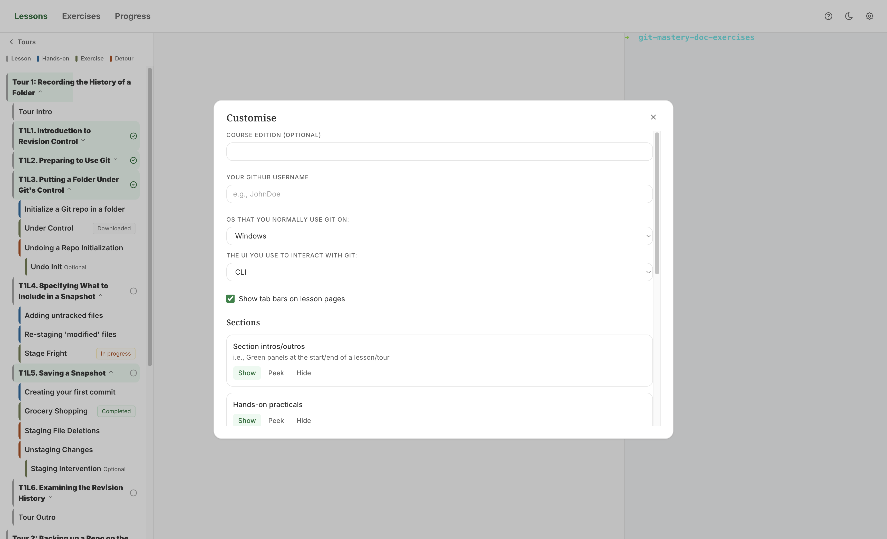

_Figure 3.5a: The Customisation panel applies course, profile, platform, and content preferences from one place._

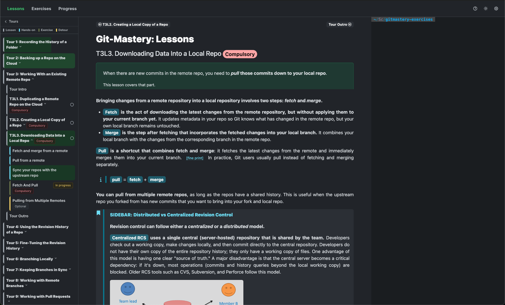

_Figure 3.5b: Dark mode, customized for CS2103 (compulsory tags are added by CS2103 course instructors)._

### 3.3 Future Plans

The application will be tested with learners who have different levels of Git experience. Field testing will focus on where users become confused during setup, navigation, exercise download, terminal use, and verification. Findings will be used to fix bugs and simplify the workflow before wider adoption.

## 4. PO2: Add AI Features

### 4.1 Contextual AI Hints and Provider Access

AI can help learners clarify theory or get unstuck during a practical. However, using a separate AI tool interrupts the learning flow and requires the learner to explain the lesson, exercise, and current repository state again.

Git-Mastery Desktop therefore provides an AI Hints panel within the work column. Each lesson, exercise, and hands-on practical has its own conversation. The panel appears above the terminal so the learner can keep the instructions, hint, and working environment visible at the same time. Conversations survive switching activities and restarting the app, but repository snapshots and credentials are not stored in chat history.

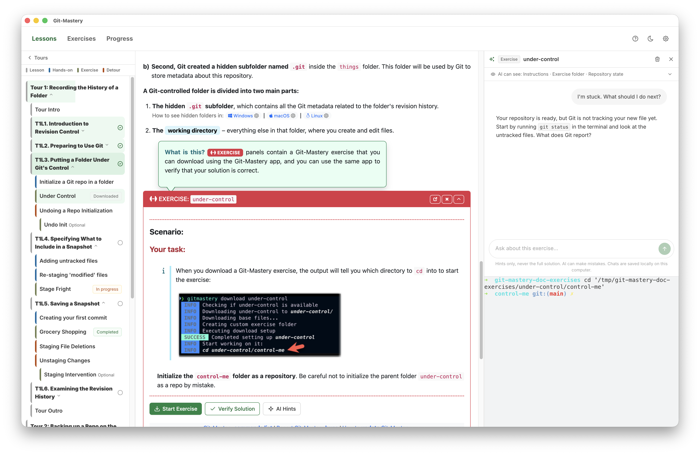

_Figure 4.1: AI Hints keeps the exercise, a contextual response, and the working terminal visible together._

Learners provide their own API key from a supported AI provider. The app currently supports Groq, OpenAI, Anthropic, Google, OpenRouter, and custom OpenAI-compatible endpoints such as Ollama or a course proxy. Keys are checked when saved and stored separately for each provider. They are encrypted when the operating system supports secure storage; otherwise, the app clearly warns that local plaintext storage is being used.

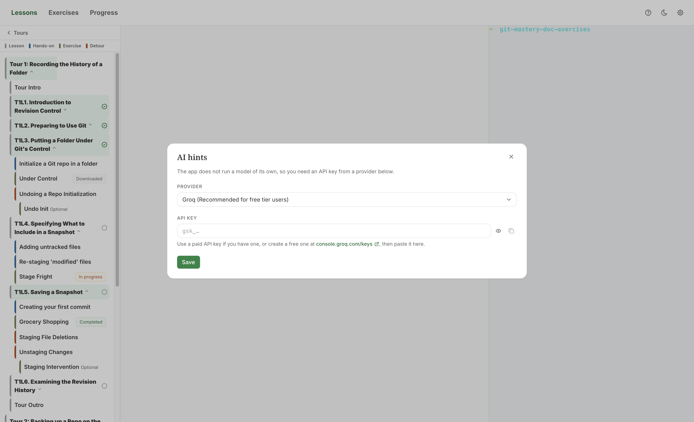

_Figure 4.2: Learners select an AI provider and configure their own API key._

This Bring Your Own Key approach was chosen for the MVP because it does not require the project to fund and operate a shared proxy. It is also an established approach in developer tools: Visual Studio Code allows users to connect their own keys for multiple cloud providers, custom endpoints, and local models while retaining the same chat interface [5]. This precedent does not remove the setup burden for learners, but it demonstrates that provider choice and user-owned credentials can support an AI feature without making one provider essential to the product.

A shared key should not be embedded in the Electron application because a packaged desktop client can be inspected and its credential reused. MITRE classifies hard-coded outbound credentials as a software weakness and recommends keeping credentials outside the code in protected storage [6]. A centrally managed token pool would avoid placing the key in the client, but it would require the project to operate authentication, quotas, abuse prevention, and ongoing funding. BYOK was therefore the more practical boundary for the MVP.

### 4.2 Context and Tutoring Policy

AI Hints uses the current lesson or activity instructions as context. For exercises and hands-on practicals, those instructions alone are not enough: a beginner may be unable to explain what they have already attempted or why verification failed.

Repository-aware assistance is already used by GitHub Copilot, which uses a repository's files and symbols as context to ground answers about that codebase [7]. Git-Mastery Desktop applies the same general idea more narrowly. It sends only the Git state and exercise information needed to identify the learner's current progress, rather than providing unrestricted access to the repository.

For this reason, the app collects a fresh, read-only snapshot of the exercise folder for each request. It may include:

- the current branch or detached HEAD state;
- recent commit subjects;
- local branch, tag, remote, and stash names;
- whether a merge or other Git operation is paused;
- changed filenames and whether they are staged; and
- question prompts from approved exercise files, without the learner's answers.

The tutoring policy depends on the activity:

- For lessons, the AI may explain concepts and provide examples.
- For graded exercises, it should diagnose the current state and give one next step or guiding question without supplying answer-file values or completed file contents.
- For hands-on practicals, it may explain the current command but should not run ahead of the learner.

### 4.3 Safety, Privacy, and Limits

The current AI Hints feature is read-only. It cannot execute Git or terminal commands, modify files, or approve an exercise on the learner's behalf. This limits the consequence of an unsafe suggestion: the learner must decide whether to enter a command, and the Git-Mastery CLI remains responsible for verification.

The main remaining risks are unnecessary data disclosure, answer leakage, and unsafe advice. Context collection therefore uses technical restrictions rather than relying only on the model prompt. The app does not send arbitrary file contents, answer values, terminal history, credentials, usernames, home-directory paths, or files outside the exercise folder. Directory listings contain names but not file contents; question text is read only from manifest-approved files and answer lines are removed; symlinks are not followed; and repository paths are checked to remain inside the exercise folder. Git is also prevented from discovering a repository above that folder.

These restrictions follow the data-minimisation principle in the NIST Privacy Framework, which recommends managing data consistently with privacy risk and allowing selective collection or disclosure of individual data elements [8]. Before sending a request, the context preview allows the learner to inspect the bounded information that will leave the computer.

_Figure 4.3: The context preview makes the exercise and repository information sent with a request visible to the learner._

API keys are stored using Electron's operating-system-backed secure storage where it is available. If secure storage is unavailable, the settings panel explicitly warns that the key will be stored as local plaintext. Provider-side retention and training policies are outside the application's control, so learners must still choose a provider whose terms are appropriate for their work.

Safety was also included in the provider evaluation described in Section 4.4. The rubric checks answer leakage, destructive or unnecessary commands, prompt privacy, grounding, and whether the suggested next step is safe. The selected default provider scored 68 out of 79 across nine representative scenes, produced readable responses in every scene, and did not suggest a destructive command. This is evidence about the tested cases, not a guarantee of future model behaviour. The tutoring policy may still be ignored by a model, so exercise design and verification remain the final protection against an incorrect or overly revealing response.

### 4.4 Evaluation of Free AI Providers

The goal of this evaluation was to determine which free-tier AI provider produces the best-quality diagnosis and hints while remaining usable for learners. Free providers differ not only in response quality, but also in availability, consistency, rate limits, and setup requirements.

Generic model benchmarks do not measure whether a model can follow this product's tutoring policy. OpenAI's evaluation guidance similarly recommends defining explicit success criteria, using task-specific examples that reflect real use, and combining structured metrics with human judgement instead of relying only on generic academic scores [9]. The evaluation therefore measures the complete tutoring behaviour used in the application, not the model in isolation.

The evaluation used the same system prompt, repository context, and model settings as the application. Exercises of different difficulty were prepared in three representative states:

- **Just started:** the learner has not yet made useful progress and asks for help.
- **On the right track but stuck:** the learner has completed part of the task but is blocked at an important step.
- **Off track:** the learner has made a plausible mistake that would cause verification to fail.

For each state, the expected diagnosis, safe next action, and information that should not be revealed were defined before testing. Each response was then graded using a pass-or-fail rubric covering:

- whether the response was readable and addressed to the learner;
- whether it used concrete evidence from the exercise or repository state;
- whether it correctly identified the learner's progress or mistake;
- whether it suggested a safe and useful next action;
- whether it remained focused instead of giving the full solution;
- whether it avoided revealing answer values or completed file contents;
- whether it avoided destructive or unnecessary Git commands; and
- whether it kept the system prompt and internal context private.

Variable providers were tested more than once, and their weakest completed run was considered rather than selecting only their best output. Operational usability was assessed separately by checking whether each provider consistently returned a usable response, offered a practical free quota, and could be configured by a learner without paid access. This prevents a high-quality model from being recommended if its free tier is too unreliable or limited for normal use.

### 4.5 Future Plans

The current AI Hints feature is read-only: it explains the learner's repository state but cannot act on it. A future direction is to investigate integration with a local coding agent, such as the Claude CLI, which could perform approved operations inside the exercise folder.

This would require stronger safeguards than the current chat feature. The learner should be shown what an action will do, the agent must remain restricted to the exercise folder, and destructive or unrelated operations should require explicit approval or be blocked.

Token usage affects both response time and the cost or free-tier quota consumed by the learner's chosen provider. The current limits are practical ceilings rather than response-length targets. Each context source is capped at 8,000 characters so that normal lesson instructions and Git summaries have useful space, while one unusually large source cannot dominate the prompt or repeatedly consume the learner's quota. Because the four sources are limited independently, their combined text is bounded at 32,000 characters before conversation history and the system prompt are added.

Only the latest 20 history messages—approximately ten user-assistant exchanges—are sent. This retains the recent discussion while placing a fixed bound on history that would otherwise grow and be charged again with every request. Older repository snapshots provide little value because the current state is rebuilt for each request. Responses are capped at 2,000 output tokens even though the tutoring prompt asks for a short hint. This leaves headroom for reasoning models, which may spend part of the output budget on internal reasoning, while still preventing an unexpectedly long response from consuming unbounded quota. A much tighter cap could truncate the explanation or, for some reasoning models, produce no visible answer. The application does not yet show or save provider-reported token usage, so these limits cannot yet be tuned from observed learner usage.

A future usage display will record input and output tokens for each request and show both the per-query amount and the cumulative conversation total. Where a provider publishes pricing, the app could also show an estimated cost; otherwise, it should report tokens without implying that all providers charge the same rate. Longer conversations may additionally require context compaction so that useful history can be retained without repeatedly sending every earlier message or exceeding provider limits.

## 5. PO3: Move to Production

### 5.1 Cross-Platform Releases

The prototype could be packaged locally, but this was not a reliable way to distribute the application. In particular, the terminal dependency contains native code and must be built for the correct operating system and processor architecture.

A manual GitHub release workflow was implemented. When a release is requested, it:

1. runs the project's quality checks;
2. determines the next version from the changes since the previous release;
3. builds all supported packages; and
4. publishes one GitHub release after every package succeeds.

Versioning follows strict semantic versioning and is calculated automatically by `semantic-release` from conventional commit titles on the `main` branch. Pull requests are squash-merged, so the pull-request title becomes the commit subject used for versioning. A `feat!:` title or `BREAKING CHANGE:` causes a major-version increase, `feat:` causes a minor-version increase, and other allowed types such as `fix:`, `docs:`, and `chore:` cause a patch-version increase. Automated pull-request checks enforce the conventional title format.

The versioning job updates `package.json`, `package-lock.json`, and `CHANGELOG.md`, commits the release version to `main`, and creates a `vX.Y.Z` tag. The platform builds then use that same tag, ensuring that every package and the GitHub release have a consistent version.

The current release contains:

- macOS DMGs for Apple Silicon and Intel;
- a Windows portable EXE and MSI installer; and
- a Linux AppImage and DEB package.

The packaged application is available from the [Git-Mastery Desktop v1.6.0 release](https://github.com/git-mastery/git-mastery-desktop/releases/tag/v1.6.0).

Releases are deliberately triggered manually instead of after every merge. This avoids publishing accidental versions and avoids running several expensive platform builds for ordinary development changes. The packages use consistent names containing their version, operating system, and architecture.

The current limitation is that the macOS and Windows packages are unsigned because signing credentials are unavailable. There is also no automatic updater, so update metadata is not published.

### 5.2 Quality Checks and Regression Testing

The prototype relied mainly on manual checking. Formatting, linting, and TypeScript checks were added first, but these cannot detect valid code that behaves incorrectly.

A deterministic regression suite was therefore added to the required quality checks. It protects important user-facing rules, including:

- resolving the correct and safe working directory for exercises and hands-on practicals;
- displaying lessons, exercises, detours, and practicals in the correct order;
- recognising valid AI Hints sources and links; and
- validating, limiting, recovering, and safely saving AI chat history.

These tests use fixed inputs and isolated temporary folders. They do not depend on a live website, model provider, Electron window, installed Git-Mastery CLI, or files already on the developer's computer. This keeps them fast and repeatable on both developer machines and GitHub Actions.

Packaged application behaviour, the terminal, the live lesson website, and AI response quality are still checked separately because they depend on native or external systems. Broader end-to-end testing will be considered for a small number of critical workflows.

### 5.3 Future Plans

A small end-to-end test suite will be considered for the most important complete workflows, such as launching the app, starting an exercise, using the terminal, and running verification. These tests should remain selective because packaged Electron tests are slower and more platform-dependent than the current deterministic suite.

Field testing will also be done with real Git learners, and developers. Feedback will be used to create further iterations of the product.

Future production work also includes investigating application signing and deciding whether an in-app update mechanism is justified.

## 6. PO4: Improve Internals

### 6.1 High-Level Application Architecture

Git-Mastery Desktop uses a process boundary to keep the learner interface separate from operations that can access the local machine. The application runs in one Electron window. Its React renderer owns the header, navigation, lesson controls, AI Hints panel, and xterm terminal interface, while an embedded `WebContentsView` displays the live Git-Mastery lesson website.

The renderer does not receive unrestricted filesystem or process access. A typed preload bridge exposes a limited set of operations through Electron IPC. The main process owns privileged work: running the terminal and Git-Mastery CLI, reading exercise and Git metadata, saving local configuration and history, contacting the selected AI provider, and controlling the embedded lesson view. It communicates with the learner's existing CLI, exercise folders, Git repositories, the lesson website, and the configured AI service.

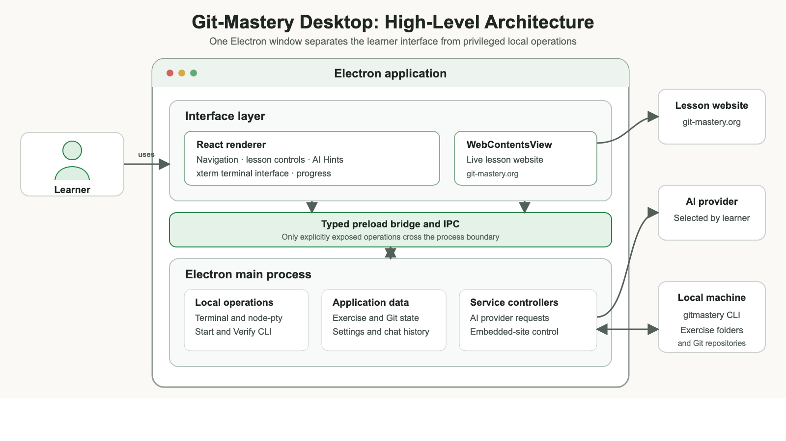

_Figure 6.1: Privileged local and provider operations remain behind a limited IPC boundary instead of being exposed directly to the renderer or lesson website._

This structure provides the context for the following internal improvements. Each change clarifies which component owns a responsibility or replaces an unreliable implicit behaviour with an explicit interface.

### 6.2 Clear Ownership of CLI Setup

Git-Mastery Desktop depends on a separate command-line application, the Git-Mastery CLI, to download exercises and verify solutions. The curriculum already teaches learners how to install this CLI and run `gitmastery setup`, which creates the folder where their exercises are stored.

**Before the change,** the desktop app tried to manage this setup itself. On Windows and Linux, it downloaded its own copy of the CLI into a learner-selected folder and placed that folder at the front of the system command search path. macOS used a different Homebrew-based installation flow. This created two competing setup processes: a learner could install the CLI by following the lesson, while the desktop app could install another copy elsewhere. Verify could then use a different executable from the one available in the terminal. Placing a general folder such as Downloads or Documents at the front of the command search path was also unsafe because an unrelated executable in that folder could be selected instead of a system command.

**After the change,** the CLI and curriculum remain responsible for installation and `gitmastery setup`; the desktop app only checks that the completed setup is available. It resolves the learner's existing `gitmastery` command through the normal system `PATH` and stores the exercises folder created by setup. When the learner first clicks Start Exercise—the action that downloads or resumes an exercise and opens its folder in the terminal—the app checks for the CLI and exercises folder. If either is missing, it links to the lesson that explains the required step and checks again the next time Start Exercise is clicked.

The platform-specific CLI download code and duplicate onboarding setup were removed. Both Start Exercise entry points—the one in the desktop interface and the one embedded in the lesson page—now use the same main-process prerequisite checks. This reduces platform-specific code, keeps terminal and desktop commands consistent, and prevents the desktop app from duplicating responsibilities already owned by the CLI.

### 6.3 Reliable Exercise Directory Resolution

Each Git-Mastery exercise is downloaded as a local folder, and the desktop app must open its terminal in the exact folder where the learner is expected to run Git commands.

The prototype guessed an exercise's working directory from its folder structure. It used the exercise root when there were no subfolders, the only subfolder when there was one, and further guesses when there were several. This could silently select the wrong folder if an exercise layout changed or the learner created an additional directory. Some exercises also intentionally begin without a Git repository because running `git init` is the task.

The embedded lesson page and desktop interface also used different Start implementations. One always downloaded the exercise again, which could delete existing work with the released Git-Mastery CLI, while the other only attempted to resume it.

The app now reads the manifest written by the CLI when an exercise is downloaded. The manifest explicitly records the repository type and folder name. All Start actions use one shared main-process flow that:

- validates the exercise identifier;
- downloads the exercise only when it is absent;
- resumes existing work without downloading again;
- resolves the intended working directory from the manifest; and
- moves the terminal to that directory.

Missing or invalid metadata is reported as an incomplete or corrupt exercise instead of triggering another guess. This keeps the desktop application's behaviour aligned with the CLI, prevents unnecessary downloads from deleting work, and avoids later verification failures caused by entering the wrong folder.

### 6.4 Separation of Interactive and Application-Controlled Commands

The app provides a real terminal for commands entered by the learner. It also provides a Start Exercise button, which downloads or resumes the selected exercise and opens its folder in the terminal, and a Verify button, which runs the Git-Mastery CLI's grading check to determine whether the exercise has been completed correctly.

An early option implemented in the prototype was to run Start and Verify directly inside the learner's interactive terminal. However, the application needs to interpret the verification result to update exercise progress and feedback. The Git-Mastery CLI remains responsible for grading, but its output states whether the solution is complete or incomplete and may include comments explaining the result. A successful process exit only shows that Verify ran; it does not show whether the learner's solution was correct.

Git-Mastery Start and Verify commands therefore run as separate child processes with an explicit working directory. This gives the app an output stream containing only that command's result, without shell prompts, colour codes, unrelated output, or text typed by the learner. The same output is copied into the visible terminal so the learner still receives one continuous terminal experience.

This separation allows the desktop interface to update progress reliably without reimplementing exercise grading or hiding detailed CLI feedback from the learner.

### 6.5 Future Plans

The current verification integration reads status and comments from human-readable CLI output. A structured output format from the Git-Mastery CLI would provide a more stable interface and remove the need to recognise specific text lines.

## 7. PO5: Leverage AI for Development

### 7.1 Tools and Division of Responsibility

AI-assisted development was used throughout the project rather than for a few isolated prompts. The tools and configurations were:

- **Claude Code, Pro plan:** Opus 5.5 at High effort for difficult architectural investigation and multi-file changes.
- **Cursor, Enterprise plan:** GPT-6.1 at High effort for substantial implementation, refactoring, and review work.
- **Cursor, Enterprise plan:** Grok at Low effort for lightweight, bounded tasks such as small edits, repository searches, and routine checks.

The coding agents performed a substantial share of the first-draft implementation. They searched the repository, traced behaviour across the renderer, preload bridge, main process, and CLI, proposed plans, edited related files, drafted tests and documentation, ran development commands, inspected diffs, and revised work after failures or review comments.

My involvement concentrated on the decisions that could not be delegated safely. I selected the problem to solve, defined the intended learner experience and non-goals, required evidence before architectural changes, challenged assumptions and unsafe options, chose between alternatives, approved the implementation plan, checked user-facing behaviour, and decided whether the resulting evidence was sufficient to accept the change. Responsibility was therefore divided by type rather than by a simple count of generated lines.

This was an iterative process rather than a single request followed by an unreviewed patch. One representative architecture task concerned the Start Exercise flow. I first defined the intended outcome, constraints, and evidence required before implementation. The agent then traced the relevant code and documentation, identified alternatives and risks, and proposed a plan. I challenged its assumptions and selected the approach before allowing implementation to begin. After the agent produced the patch and verification evidence, a separate agent session using a different model reviewed the requirements, diff, and evidence for broader changes. The fresh context reduced the chance of repeating the implementing agent's assumptions and gave me multiple perspectives to consider before choosing the direction for the next iteration.

Non-obvious decisions, boundaries, trade-offs, and rejected alternatives were then added to the relevant architecture or development document. Reusable procedures were captured in repository skills so that later agents could follow the same constraints. I reviewed the final diff, verification evidence, independent findings, and documentation before deciding whether another iteration was needed or the change could be accepted.

A representative prompt, shortened for the report, was:

> “Investigate the Start Exercise flow before editing. Trace both entry points and the related CLI behaviour, explain the risks in the current design, and compare alternatives. Do not implement until the evidence and trade-offs are explicit.”

The agent also drafted [`architecture/exercise-directory-resolution.md`](architecture/exercise-directory-resolution.md) as a durable artifact. I reviewed and refined it before accepting the change. The following excerpt shows how the document states the user consequence before recording the supporting evidence and decision:

> **Problem**
>
> Verification runs in whatever directory the terminal is sitting in, so getting the learner into the right directory is load-bearing rather than cosmetic. A wrong `cd` does not fail visibly—it surfaces later as a confusing `gitmastery verify` failure that appears to blame the learner.

### 7.2 Preserving Project Knowledge Across AI Sessions

Later AI sessions do not automatically know why an earlier decision was made. I therefore stored project context in named, version-controlled files instead of depending on a previous chat summary:

- [`AGENTS.md`](../AGENTS.md) gives every coding agent the repository-wide rules: run formatting and linting, record non-trivial architectural decisions under `docs/`, update an existing source of truth instead of adding contradictory history, and avoid unnecessary documentation.
- Architecture records under `docs/architecture/`, including [`exercise-directory-resolution.md`](architecture/exercise-directory-resolution.md), preserve the evidence, boundaries, rejected alternatives, and deferred work behind individual decisions.

Five repository skills provide task-specific procedures, and their filenames make the instructions directly inspectable:

- [`.agents/skills/git-mastery-design/SKILL.md`](../.agents/skills/git-mastery-design/SKILL.md) is used for renderer-interface work and defines the actual colour, typography, surface, component, and accessibility conventions.
- [`.agents/skills/git-mastery-pr/SKILL.md`](../.agents/skills/git-mastery-pr/SKILL.md) is used when preparing a pull request and requires a conventional title, a concise explanation, and reproducible manual test cases.
- [`.agents/skills/git-mastery-documentation/SKILL.md`](../.agents/skills/git-mastery-documentation/SKILL.md) is used for architecture records, evaluations, and reports. It requires the agent to inspect implementation evidence, update the document that owns the topic, and record non-obvious boundaries and trade-offs.
- [`.agents/skills/git-mastery-ui-testing/SKILL.md`](../.agents/skills/git-mastery-ui-testing/SKILL.md) is used after visible renderer changes. It requires navigation through every affected state, screenshot inspection, and another implementation cycle when a defect is found.
- [`.agents/skills/git-mastery-electron-automation/SKILL.md`](../.agents/skills/git-mastery-electron-automation/SKILL.md) provides the lower-level process for launching an isolated application profile, controlling the Electron window, capturing evidence, and removing temporary review artifacts.

These are not general recommendations added only for this report. Agents read the applicable files during project work, and corrections that needed to persist were moved from chat into these repository artifacts. GitHub documents the same use of repository instructions to preserve project context and conventions across AI sessions [11].

### 7.3 Harness Engineering, Guardrails, and Human Control

AI-produced patches were not accepted based on the agent's completion message. The project used repository instructions, skills, architecture records, diffs, automated checks, independent review, and manual verification to produce evidence that could be checked separately from the model's claims.

Git-Mastery Desktop uses three practical layers of feedback. The AI coding agent applies the checks relevant to each change:

- **Maintainability checks:** Prettier enforces formatting, ESLint reports code-quality problems, and TypeScript compilation detects invalid interfaces across the renderer, preload bridge, and main process.
- **Behaviour checks:** the Vitest suite exercises deterministic rules such as safe directory resolution and parsing logic.
- **Architecture and runtime checks:** architecture records and the design skill guide process boundaries, while the UI-testing and Electron-automation skills provide a repeatable way to exercise changed flows and inspect screenshots. A person still checks cases that cannot be established by the deterministic suite or agent review alone, such as terminal interaction, live website integration, and packaged installers.

The ordinary CI workflow independently installs dependencies and runs linting, a formatting check, TypeScript compilation, and the regression suite for every pull request and push to `main`. The PR-lint workflow separately checks the conventional title and required pull-request sections. The manually triggered release workflow repeats the quality gate before any version or installer is published.

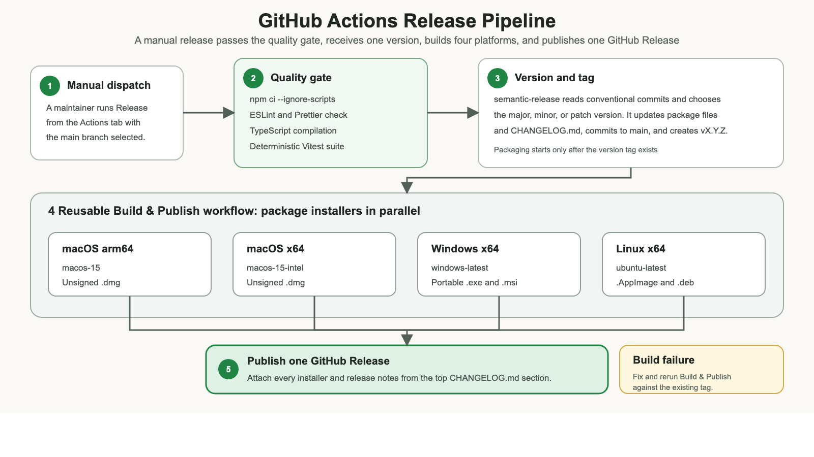

_Figure 7.2: The GitHub Actions release pipeline publishes one version only after its quality gate and all four platform-packaging jobs succeed._

As shown in Figure 7.2, a maintainer starts the Release workflow from the Actions tab with `main` selected. After the quality gate passes, `semantic-release` derives one semantic version from conventional commits, updates the package files and changelog, commits the version, and creates its tag. A reusable workflow then builds macOS arm64, macOS x64, Windows x64, and Linux x64 installers in parallel. The publish job runs only after all package jobs succeed and creates or updates one GitHub Release containing every installer and the release notes. If packaging fails after the tag is created, Build & Publish can be rerun against that same tag.

These workflows reduce reliance on an AI coding agent's claims by rerunning deterministic checks in a fresh environment. Human control remains at the points where the evidence is incomplete or the consequence is high: I review the diff, decide whether an architectural trade-off is acceptable, perform native and visual checks, and manually start a release. This also follows GitLab's recommendation to keep the repository as the source of truth and turn repeated corrections into tests, rules, or documentation [10].

### 7.4 Future Plans

The next improvements will evaluate and enforce the AI development workflow more directly:

- **Skill evaluation:** maintain example requests that should and should not trigger each skill, then check whether the required steps, commands, outputs, and cleanup were completed.
- **Agent completion gate:** provide one verification command for formatting, linting, TypeScript, and tests, with an end-of-turn hook that prevents an agent from declaring completion while it fails or temporary review artifacts remain.
- **Independent review protocol:** give a separate model session the requirements, diff, and verification evidence, then classify each finding as confirmed, refuted, or unresolved before a human decides whether to accept the change.

## References

[1] Microsoft, “Terminal Basics,” _Visual Studio Code Documentation_. [Online]. Available: [https://code.visualstudio.com/docs/terminal/basics/](https://code.visualstudio.com/docs/terminal/basics/). [Accessed: Oct. 25, 2026].

[2] Microsoft, “Visual Studio Code Tips and Tricks,” _Visual Studio Code Documentation_. [Online]. Available: [https://code.visualstudio.com/docs/editing/getting-started/tips-and-tricks](https://code.visualstudio.com/docs/editing/getting-started/tips-and-tricks). [Accessed: Oct. 25, 2026].

[3] B. Harkin, T. L. Webb, I. Chang, A. Prestwich, M. Conner, I. Kellar, Y. Benn, and P. Sheeran, “Does monitoring goal progress promote goal attainment? A meta-analysis of the experimental evidence,” _Psychological Bulletin_, vol. 142, no. 2, pp. 198–229, 2016, doi: [10.1037/bul0000025](https://doi.org/10.1037/bul0000025).

[4] Nielsen Norman Group, “10 Usability Heuristics for User Interface Design.” [Online]. Available: [https://www.nngroup.com/articles/ten-usability-heuristics/](https://www.nngroup.com/articles/ten-usability-heuristics/). [Accessed: Oct. 25, 2026].

[5] Microsoft, “Understand Language Models,” _Visual Studio Code Documentation_. [Online]. Available: [https://code.visualstudio.com/docs/agents/concepts/language-models](https://code.visualstudio.com/docs/agents/concepts/language-models). [Accessed: Oct. 26, 2026].

[6] MITRE, “CWE-798: Use of Hard-coded Credentials.” [Online]. Available: [https://cwe.mitre.org/data/definitions/798.html](https://cwe.mitre.org/data/definitions/798.html). [Accessed: Oct. 26, 2026].

[7] GitHub, “Using GitHub Copilot to Explore a Codebase,” _GitHub Docs_. [Online]. Available: [https://docs.github.com/en/copilot/tutorials/explore-a-codebase](https://docs.github.com/en/copilot/tutorials/explore-a-codebase). [Accessed: Oct. 26, 2026].

[8] National Institute of Standards and Technology, _NIST Privacy Framework: A Tool for Improving Privacy through Enterprise Risk Management, Version 1.0_, 2020, doi: [10.6028/NIST.CSWP.01162020](https://doi.org/10.6028/NIST.CSWP.01162020).

[9] OpenAI, “Evaluation Best Practices,” _OpenAI API Documentation_. [Online]. Available: [https://developers.openai.com/api/docs/guides/evaluation-best-practices](https://developers.openai.com/api/docs/guides/evaluation-best-practices). [Accessed: Oct. 26, 2026].

[10] GitLab, “AI-Assisted Development Playbook,” _The GitLab Handbook_. [Online]. Available: [https://handbook.gitlab.com/handbook/engineering/workflow/ai-assisted-development/](https://handbook.gitlab.com/handbook/engineering/workflow/ai-assisted-development/). [Accessed: Oct. 26, 2026].

[11] GitHub, “Custom Instructions for GitHub Copilot,” _GitHub Docs_. [Online]. Available: [https://docs.github.com/en/copilot/concepts/prompting-and-context/custom-instructions](https://docs.github.com/en/copilot/concepts/prompting-and-context/custom-instructions). [Accessed: Oct. 26, 2026].
